# Option-Implied Information and the Physical Return Density of the S&P 500

**IE 612 course project.** Does the information in S&P 500 option prices (the risk-neutral, **Q**, measure) improve forecasts of the *physical* (**P**) distribution of next-day index returns? We forecast the full one-day return density with Student-t regressions fed by option-implied moments and historical risk measures, score them out of sample by log score, and compare them against naive baselines, a latent-regime extension, and a GJR-GARCH benchmark. All tests use walk-forward refits and decision rules committed before the data was scored.

<p align="center">
  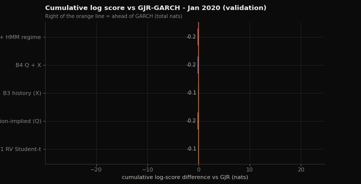
</p>

## Findings at a glance

| | Validation 2020-2021 | Test 2022-2023 (post-hoc) |
|---|---|---|
| **Q1: do option features add to historical features?** (B4 vs B3) | **+0.033 nats/day**, DM p = 0.020, bootstrap CI [+0.003, +0.063] | +0.012 nats/day, **p = 0.052** (pre-declared primary test, not rejected at 5%) |
| **Options vs the GARCH benchmark** (B4 vs GJR-GARCH-t) | **+0.045 nats/day**, p = 0.010, survives recalibration | -0.004 nats/day, p = 0.65 (a statistical tie) |
| **Options alone vs trailing realised volatility** (B2 vs B1) | **+0.088**, p < 0.001 | +0.016, p = 0.090 |
| **Does an HMM regime add value?** (R1 vs B4) | -0.004, p = 0.83 (no) | +0.008, p = 0.025, CI includes 0, all from 2022 (fragile) |
| **Calibration of the option models** | passes PIT/KS (B2, B4, R1) | intervals too narrow (50% band covers ~44%) |

**In one sentence:** 30-day option-implied information gives a clear but modest improvement over naive and history-only density forecasts at the one-day horizon. It beats a GJR-GARCH benchmark in 2020-2021 and ties it in 2022-2023, and most of its value comes through the forecast's **scale** rather than its shape. That is the pattern the literature predicts when the option maturity (30 days) is much longer than the forecast horizon (1 day) (Shackleton, Taylor & Yu, 2010, *Journal of Banking & Finance*). This project replicates and extends that evidence on recent data; it makes no novelty claim.

<p align="center"></p>

---

## Contents
1. [Research question](#1-research-question)
2. [Data and design](#2-data-and-design)
3. [Models](#3-models)
4. [Evaluation protocol](#4-evaluation-protocol)
5. [Making the estimates trustworthy](#5-making-the-estimates-trustworthy)
6. [Results: validation 2020-2021](#6-results-validation-2020-2021)
7. [Results: test 2022-2023 (post-hoc)](#7-results-test-2022-2023-post-hoc)
8. [Benchmark: GJR-GARCH](#8-benchmark-gjr-garch)
9. [Calibration](#9-calibration)
10. [Controls, recalibration and ablations](#10-controls-recalibration-and-ablations)
11. [Interpretation and limitations](#11-interpretation-and-limitations)
12. [Reproducing the results](#12-reproducing-the-results)
13. [Repository map](#13-repository-map)
14. [Figure gallery](#14-figure-gallery)

---

## 1. Research question

Option prices are forward-looking: implied volatility, skew and tail prices reflect the market's view of future risk, plus risk premia. Historical returns are backward-looking but measured under the physical measure we care about. The project asks whether Q information sharpens the **one-day-ahead physical return density**, and where that value lies.

| Question | Comparison | Meaning of a positive result |
|---|---|---|
| **Q1** (primary) | B4 vs B3 | option features add to historical-state features |
| **Q2** | B2 vs B1, B2 vs B0 | option features alone beat simple P baselines |
| **Q3** | B3 vs B1 | historical features beat trailing RV (context for Q1) |
| Regime (secondary) | R1 vs B4 | a causally filtered HMM regime adds to Q + X |
| Benchmark | B4, B2 vs GJR-GARCH-t | the option models beat a standard volatility model |

## 2. Data and design

- **Source:** OptionsDX end-of-day SPX option chains, 2010-2023 (licensed; raw files stay in a local `Data/` folder and are never committed). Derived feature files are committed under `output/stage7_datasets/` and `output/stage8_test/`.
- **Target:** $y_t = \ln(S_{t+2}/S_{t+1})$, the log return starting the session *after* the option snapshot, which avoids overlap with a possible post-close quote snapshot.
- **Option-implied features (Q, 30-day constant maturity):** `SVIX_30d` (Martin 2017), BKM risk-neutral skewness `QSkew_30d` and kurtosis `QKurt_30d` (Bakshi, Kapadia & Madan 2003), `ATM_IV_30d`, and the term slope `TermSlope_60_30`.
- **Historical-state features (X):** `r_1d`, `r_5d`, `rv_5d`, `rv_20d`, downside semivariance `dsemi_20d`, drawdown `dd_20d`.
- **Partitions:** development 2010-2019 (2,516 sessions), validation 2020-2021 (505 sessions, 494 scored), test 2022-2023 (501 sessions; primary sample N = 500 excludes 2022-01-03, a disclosed data-exposure date).

<p align="center">
  
  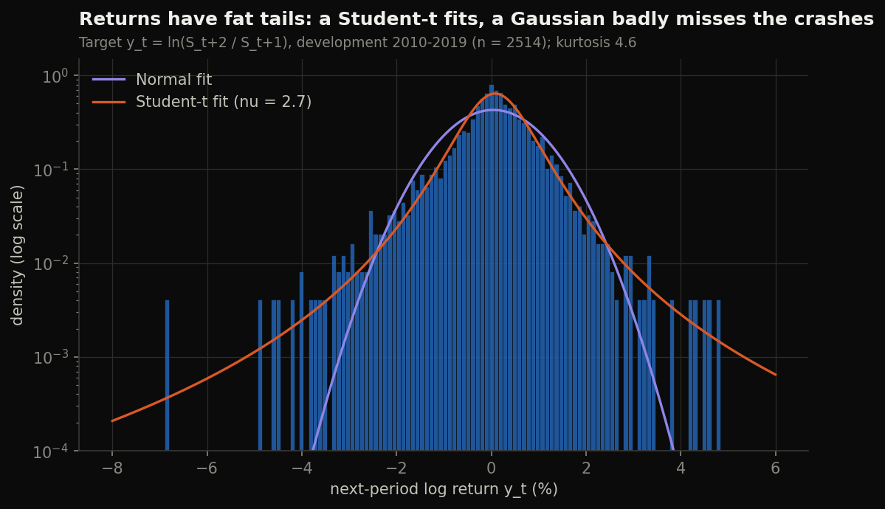
</p>
<p align="center">
  
  
</p>

Returns are fat-tailed (excess kurtosis 4.6 over 2010-2019), so every conditional model uses Student-t errors. The features are strongly collinear: SVIX and ATM IV correlate at 0.99, and BKM skewness and kurtosis at -0.97. That collinearity mattered later (Section 5).

## 3. Models

| Model | Inputs | Predictive density |
|---|---|---|
| **B0** | none | Gaussian, expanding mean and variance |
| **B1** | `rv_20d` | Student-t, scale $a_0 + a_1\,\mathrm{RV}_{20}$ |
| **B2** | Q (5) | Student-t regression: $\mu = x^\top w_\mu + b_\mu$, $\sigma = \mathrm{softplus}(x^\top w_\sigma + b_\sigma) + 10^{-4}$, constant $\nu > 2.1$ |
| **B3** | X (6) | same Student-t regression |
| **B4** | Q + X (11) | same, the primary non-regime model |
| **R1** | Q + X + filtered HMM probabilities | same; 2-state Gaussian HMM on standardised return and RV, forward-filtered (never smoothed) |
| **GJR** | daily returns | GJR-GARCH(1,1) with standardised Student-t errors, two-step-ahead density (benchmark) |

The regressions are fitted by penalised maximum likelihood (ridge on the weights) and refit every 21 sessions on an expanding window. Labels enter training only once they have matured ($t \le \tau - 2$ at refit $\tau$).

<p align="center">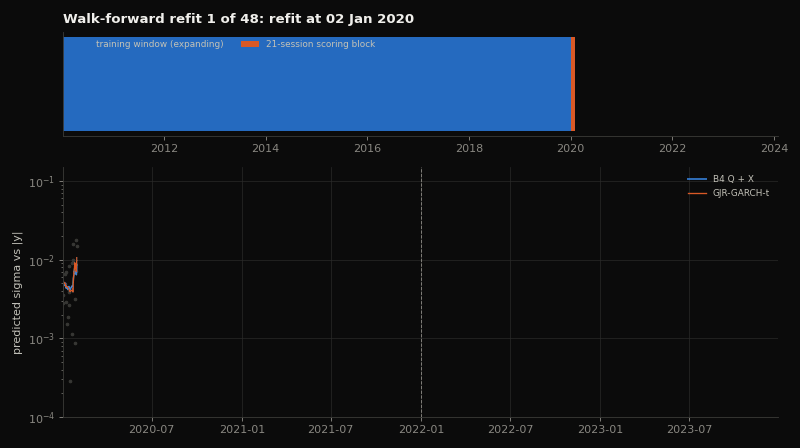</p>

## 4. Evaluation protocol

- **Score:** out-of-sample log score $\log p_t(y_t)$ (a proper scoring rule); differences $d_t = \log p_A(y_t) - \log p_B(y_t)$, positive favouring A.
- **Inference:** one-sided Diebold-Mariano tests with Newey-West HAC variance at **5, 10 and 21 lags**; stationary block bootstrap 95% CIs (2,000 replications, mean block length 5); breakdowns by year and by 21-session block; a sensitivity check excluding the March-April 2020 stress window.
- **Calibration:** PIT histograms with KS tests, and 50/80/95% central-interval coverage.
- **Pre-registration:** every decision rule was written down and committed before the corresponding run. That covers the clipping rule (`output/stage7_models_v2/step6_decision_rule.md`), the recalibration and ablation specification (`step7_specification.md`), the GARCH benchmark (`benchmark_gjr_specification.md`), the test re-score protocol (`output/stage8_test_v2/step8_test_protocol.md`) and its benchmark addendum. The 2022-2023 test set had already been scored at the original Gate D, so every test result here is labelled **post-hoc**.

## 5. Making the estimates trustworthy

An audit of the original pipeline found three problems that biased the model comparisons. All three were fixed, and each fix is covered by tests (35 pass).

**Root cause 1: the optimiser stopped far from the optimum.** A single 60-iteration float32 L-BFGS step left every B2-R1 fit about 0.01-0.04 nats short of its optimum. The cause was a Hessian condition number of about $10^8$: the location parameters have curvature of about $1/\sigma^2$. The fix optimises the location weights in units of $\mathrm{sd}(y)$ in float64, runs L-BFGS in chunks, and finishes with an exact-Hessian damped-Newton polish. A fit counts as converged only when max|grad| ≤ 1e-8 *and* the Hessian is positive definite. Every fit now matches an independent SciPy optimum to about 1e-13, and random restarts agree to 1e-13 in log score.

<p align="center">
  
</p>
<p align="center">
  
  
</p>

**Root cause 2: unequal optimisation error biased the comparisons.** B4 was the least converged, so it scored *worse* in-sample than B2, a model it contains. Once every fit converges, the nesting order is restored, and R1's earlier edge over B4 disappears.

**Root cause 3: the scale extrapolated under extreme inputs.** In March 2020 the features reached 10-16 robust z-scores, and the linear scale equation predicted *daily* σ of 0.7-1.8. A pre-declared control clips each scaled feature at scoring time to its training [0.5%, 99.5%] range. It passed both pre-declared criteria (σ < 0.10, and no model worse by more than 0.005 nats) and was adopted.

<p align="center">
  
  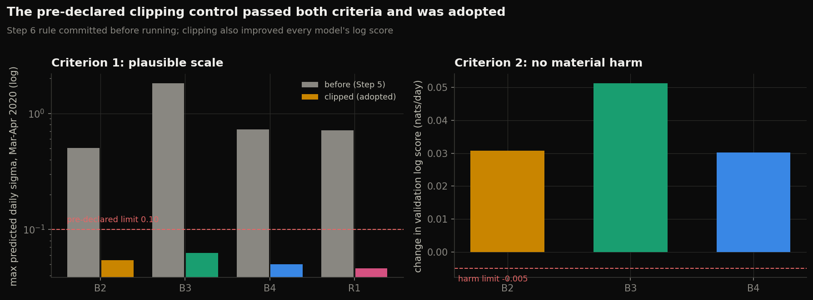
</p>

Other fixes:
- the B0 PIT was computed with the first row's parameters for every row (validation KS p is 0.0017, not 0.044);
- the HMM now monitors its true log-likelihood and records convergence;
- the B1 fit now converges (its ν was stuck at the starting value 5.0).

## 6. Results: validation 2020-2021

All numbers are for the adopted (clipped) configuration with λ = 1e-4, which the Stage 7 rule selected (figure 14); N = 494.

| Comparison | mean d | DM p (lag 5 / 10 / 21) | 95% bootstrap CI | ex-stress | blocks > 0 |
|---|---|---|---|---|---|
| Q1: B4 vs B3 | **+0.0328** | 0.020 / 0.016 / 0.009 | [+0.003, +0.063] | +0.036 (p 0.019) | 17 / 24 |
| Q2a: B2 vs B1 | **+0.0880** | < 0.001 | [+0.043, +0.146] | +0.068 | |
| Q3: B3 vs B1 | **+0.0553** | 0.021 | [+0.005, +0.117] | +0.035 | 19 / 24 |
| R1 vs B4 | -0.0040 | 0.83 | [-0.013, +0.003] | +0.001 | 10 / 24 |
| B4 vs GJR | **+0.0445** | 0.010 (lag 5), 0.008 (lag 21) | [+0.010, +0.084] | +0.051 (p 0.006) | |

<p align="center">
  
</p>
<p align="center">
  
  
</p>

<p align="center">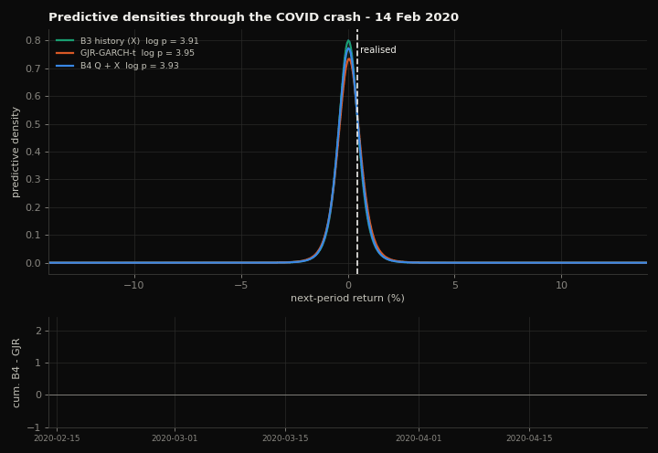</p>

## 7. Results: test 2022-2023 (post-hoc)

The configuration was frozen on validation and scored once on the test period under the committed protocol (N = 500).

| Comparison | mean d | DM p (lag 5 / 21) | 95% bootstrap CI | 2022 / 2023 |
|---|---|---|---|---|
| **Q1: B4 vs B3 (primary)** | +0.0121 | **0.052** / 0.026 | [-0.002, +0.027] | +0.018 / +0.006 |
| Q2a: B2 vs B1 | +0.0163 | 0.090 | [-0.007, +0.040] | +0.007 / +0.026 |
| Q2b: B2 vs B0 | +0.0922 | 0.001 | [+0.033, +0.151] | +0.102 / +0.083 |
| Q3: B3 vs B1 | -0.0036 | 0.61 | [-0.029, +0.022] | -0.024 / +0.017 |
| R1 vs B4 | +0.0076 | 0.025 | [-0.0002, +0.016] | +0.019 / -0.004 |

The primary test **does not reject equal accuracy at 5%** (p = 0.052). The effect has the same sign as on validation but is about a third of the size. Neither clipping nor the strict exclusion of 2022-01-03 from training changes the result. With prequential recalibration, Q1 is +0.017 (p = 0.005), the reverse of the validation pattern, so the recalibration effect itself is not stable across periods. The original Gate D (unconverged) predictions had shown Q1 = +0.019 (p = 0.033) on test (figure 36).

<p align="center">
  
  
</p>
<p align="center">
  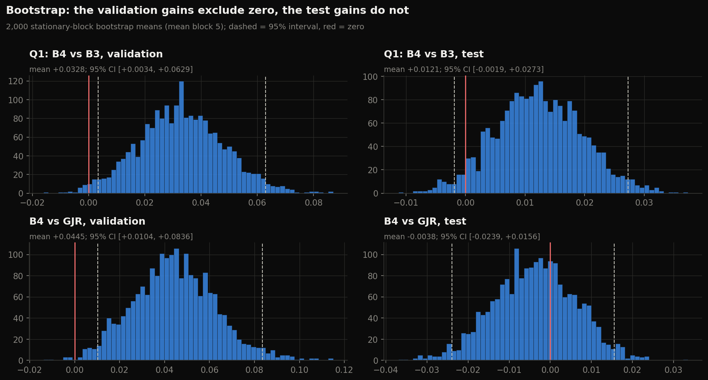
  
</p>

## 8. Benchmark: GJR-GARCH

GJR-GARCH(1,1) with Student-t errors is the standard benchmark for daily index return densities. It was fitted at the same refit origins, on returns up to the origin only, and produces a two-step-ahead density for $y_t = r_{t+2}$; the alignment is verified against an independent recursion in tests. The fitted model is pure asymmetry: α ≈ 0, leverage γ ≈ 0.33, persistence ≈ 0.97, ν ≈ 5.4.

| | B4 vs GJR | B2 vs GJR | B3 vs GJR | B1 vs GJR |
|---|---|---|---|---|
| Validation | **+0.0445** (p 0.010) | **+0.0444** (p 0.014) | +0.012 (p 0.16) | -0.044 |
| Validation, recalibrated | **+0.038** (p 0.010) | **+0.036** (p 0.017) | +0.022 (p 0.014) | -0.059 |
| Test (post-hoc) | -0.0038 (p 0.65) | +0.0040 (p 0.35) | -0.016 (p 0.96) | -0.012 |

On validation the option models beat GARCH, and history alone does not. On test the two are statistically tied.

<p align="center">
  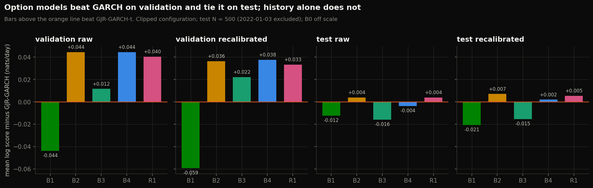
</p>
<p align="center">
  
  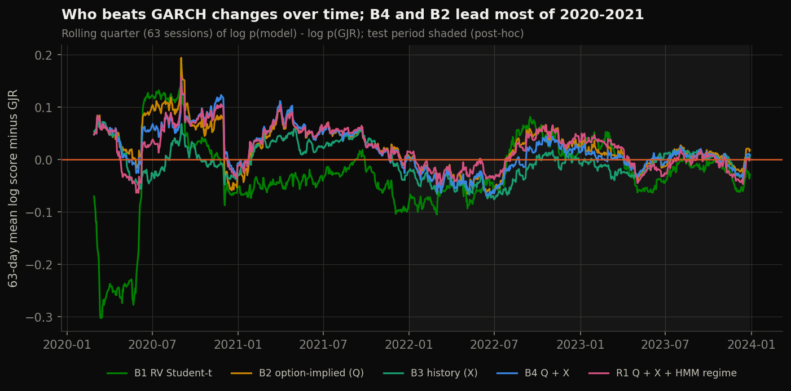
</p>

## 9. Calibration

| PIT KS p-value | B0 | B1 | B2 | B3 | B4 | R1 | GJR |
|---|---|---|---|---|---|---|---|
| Validation | 0.002 | 0.027 | **0.118** | 0.010 | **0.075** | **0.052** | 0.007 |
| Test | 0.364 | 0.110 | 0.005 | 0.010 | 0.006 | 0.008 | 0.079 |

In 2020-2021 only the option-based models pass the uniformity test. In 2022-2023 their intervals are too narrow: the 50% interval covers about 44% of outcomes, and the 80% interval about 73-75%. GARCH and B1 pass there.

<p align="center">
  
  
</p>
<p align="center">
  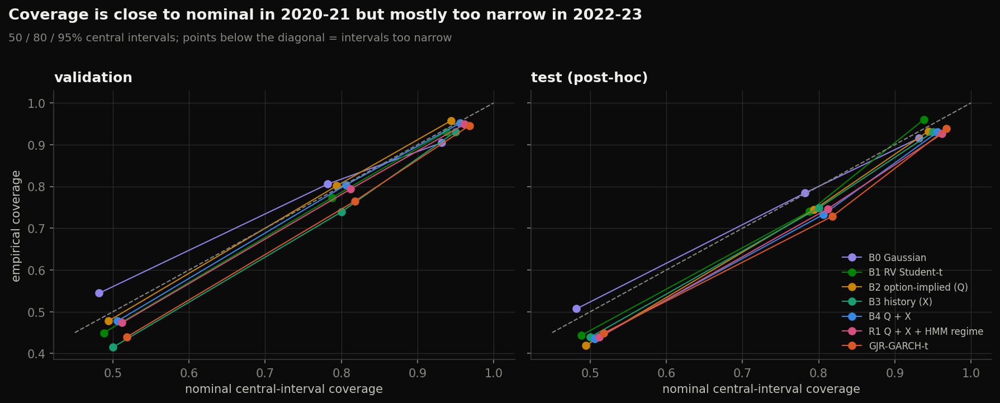
</p>
<p align="center">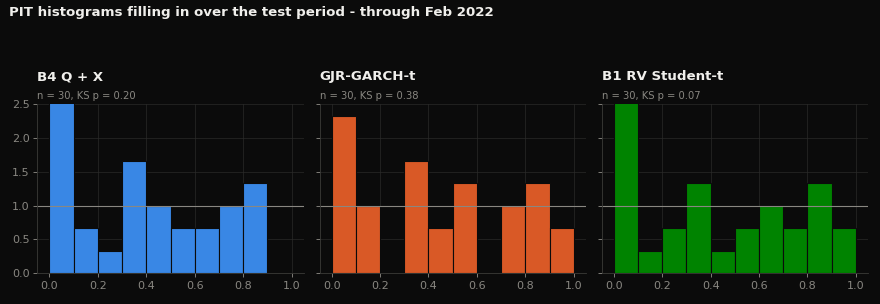</p>

## 10. Controls, recalibration and ablations

- **Width control (prequential recalibration).** Each block's scale factor is fitted only on matured past rows. Under this control, validation Q1 halves to +0.016 (p = 0.095), which shows that much of the option gain over history is better-calibrated *scale*. The option advantage over GARCH survives it (+0.038, p = 0.010).
- **Regime ablations** (research protocol §7.2). Shuffling the HMM probabilities across dates (-0.002 vs R1, p 0.65) or replacing them with a static "RV above training median" indicator (+0.001, p 0.36) changes nothing. The HMM regime's timing carries no information beyond Q + X.

<p align="center">
  
  
</p>
<p align="center">
  
  
</p>

## 11. Interpretation and limitations

**What the evidence supports.**
- At a one-day horizon, 30-day option information is mainly a better-informed but biased **scale** signal.
- It clearly beats naive baselines in both periods. It beats a GARCH benchmark in 2020-2021 and ties it in 2022-2023.
- A latent-regime layer adds nothing once option and historical features are present.

These patterns match the literature's horizon split: risk-transformed option densities beat historical ones at 2-4 weeks but not at 1 day (Shackleton, Taylor & Yu, 2010). The variance risk premium also biases implied volatility upward (Bollerslev, Tauchen & Zhou, 2009). A literature review and the extensions it suggests are in [`docs/literature/`](docs/literature/).

**Limitations.**
- One index, one horizon and one option maturity.
- The test period was already observed before these fixes, so test results are post-hoc. No fresh (2024+) data is available.
- λ and the clipping control were chosen on validation, under pre-declared rules.
- Five secondary comparisons are reported without a multiple-comparison correction.
- The option models' intervals are too narrow in 2022-2023.
- Stronger benchmarks that need intraday data (HAR-RV, Realized GARCH) were not run.
- No trading or portfolio performance is claimed.

## 12. Reproducing the results

Requirements: Python 3.13 with `numpy`, `scipy`, `pandas`, `torch`, `arch`, `matplotlib`, `pytest`. Run everything from the repository root.

```bash
python -m pytest tests                          # 35 tests: likelihoods, gradients, convergence, HMM, recalibration, GARCH, controls
python scratch/run_stage7_v2_validation.py      # validation walk-forward with converged fits (~15 min)
python scratch/run_step6_sigma_controls.py      # pre-declared clipping control (~15 min)
python scratch/run_step7_width_controlled.py    # recalibration and regime ablations (~15 min)
python scratch/run_benchmark_gjr_validation.py  # GJR-GARCH benchmark on validation (~3 min)
python scratch/make_figures.py                  # every figure and GIF from committed results (--png-only skips GIFs)
```

The test-period scripts (`scratch/run_stage8_v2_test_rescore.py`, `scratch/run_benchmark_gjr_test.py`) have already been run once under their committed protocols. Re-running them would be another look at the test set, so treat their committed outputs in `output/stage8_test_v2/` as the record. Rebuilding the option features from raw chains requires the licensed OptionsDX files; see [`docs/reproducibility_guide.md`](docs/reproducibility_guide.md).

## 13. Repository map

| Path | Contents |
|---|---|
| `src/models/` | density models and the converged optimiser, HMM filter, walk-forward pipeline, evaluation metrics, paired comparisons, recalibration, GARCH benchmark |
| `src/features/` | option-chain cleaning, SVIX/BKM moments, historical features |
| `tests/` | unit and integration tests, including an independent SciPy reference optimiser |
| `scratch/` | run scripts for every step, each with its own documented protocol |
| `output/stage7_models_v2/` | validation results, decision rules and specifications (this work) |
| `output/stage8_test_v2/` | post-hoc test re-score and benchmark, with protocols |
| `output/stage7_models/`, `output/stage8_test/` | the original Stage 7 / Gate D record (unchanged) |
| `figures/`, `figures/gifs/` | 39 figures and 5 animations |
| `docs/` | research protocol, modelling specification, data audits, gate reports, original final report and presentation |
| `docs/literature/` | literature review on option-implied physical densities and possible extensions |

## 14. Figure gallery

| # | Figure | # | Figure |
|---|---|---|---|
| 01 | [S&P 500 and partitions](figures/01_spx_price_partitions.png) | 21 | [Log score vs GJR by setting](figures/21_log_score_vs_gjr.png) |
| 02 | [Daily returns](figures/02_daily_returns.png) | 22 | [Cumulative Q1 gain](figures/22_cumulative_q1.png) |
| 03 | [Return distribution](figures/03_return_distribution.png) | 23 | [Cumulative gain vs GJR](figures/23_cumulative_vs_gjr.png) |
| 04 | [QQ plots](figures/04_qq_plots.png) | 24 | [Cumulative R1 vs B4](figures/24_cumulative_r1.png) |
| 05 | [Option-implied features](figures/05_option_features.png) | 25 | [Block heatmap, validation](figures/25_block_heatmap_validation.png) |
| 06 | [Historical features](figures/06_history_features.png) | 26 | [Block heatmap, test](figures/26_block_heatmap_test.png) |
| 07 | [Feature correlations](figures/07_feature_correlation.png) | 27 | [Forest plot, all comparisons](figures/27_forest_all_comparisons.png) |
| 08 | [Implied vs realised volatility](figures/08_implied_vs_realised.png) | 28 | [DM p-values by HAC lag](figures/28_dm_pvalues_by_lag.png) |
| 09 | [Convergence gap](figures/09_convergence_gap.png) | 29 | [Bootstrap distributions](figures/29_bootstrap_distributions.png) |
| 10 | [Degrees of freedom](figures/10_nu_stuck_vs_converged.png) | 30 | [PIT, validation](figures/30_pit_validation.png) |
| 11 | [Iterations per refit](figures/11_iterations_per_refit.png) | 31 | [PIT, test](figures/31_pit_test.png) |
| 12 | [Hessian eigenvalues](figures/12_hessian_min_eigenvalue.png) | 32 | [Interval coverage](figures/32_interval_coverage.png) |
| 13 | [Nesting restored](figures/13_nesting_restored.png) | 33 | [Clipping control](figures/33_step6_clipping_control.png) |
| 14 | [Lambda grid](figures/14_lambda_grid.png) | 34 | [Recalibration factors](figures/34_recalibration_factors.png) |
| 15 | [Sigma blow-up, March 2020](figures/15_sigma_blowup_march_2020.png) | 35 | [Regime ablations](figures/35_regime_ablations.png) |
| 16 | [Sigma paths, validation](figures/16_sigma_paths_validation.png) | 36 | [Original vs this work](figures/36_original_vs_this_work.png) |
| 17 | [Sigma paths, test](figures/17_sigma_paths_test.png) | 37 | [GJR parameters](figures/37_gjr_parameters.png) |
| 18 | [Fan chart, validation](figures/18_fan_chart_validation.png) | 38 | [Rolling log score vs GJR](figures/38_rolling_log_score_vs_gjr.png) |
| 19 | [Fan chart, test](figures/19_fan_chart_test.png) | 39 | [Results scorecard](figures/39_results_scorecard.png) |
| 20 | [HMM regime probability](figures/20_hmm_regime_probability.png) | | |

**Animations:**
- [densities through the COVID crash](figures/gifs/g1_densities_covid_crash.gif)
- [log-score race vs GARCH](figures/gifs/g2_log_score_race_vs_gjr.gif)
- [scrolling test-period fan chart](figures/gifs/g3_test_fan_chart_scroll.gif)
- [PIT histograms filling in](figures/gifs/g4_pit_buildup_test.gif)
- [walk-forward refits](figures/gifs/g5_walk_forward_refits.gif)

<p align="center">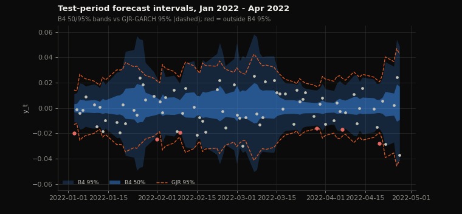</p>

---

*Raw OptionsDX data is licensed and is not redistributed. Results on 2022-2023 are post-hoc because that period was observed before the fixes described here.*
