# Option-Implied Information and the Physical Return Density of the S&P 500: Complete Research and Engineering Report

**Course:** IE 612 · **Repository:** `VatshVan/option-regimes` · **Branch documented:** `fix/optimizer-calibration` (HEAD `4f92e33` when this report was written)
**Status of this document:** a new, comprehensive report. It does not replace the original gate reports, the original final report or the research protocol, all of which remain in `docs/` as the historical record.

> **How to read this report.** Every numerical claim is tied to a repository artifact. Results from different **experiment generations** are never pooled in one table without a provenance label:
>
> | Label | Generation | Where it lives |
> |---|---|---|
> | **O-VAL** | Original Stage 7 validation (Gate C), unconverged float32 fits, λ = 0.01 | `output/stage7_models/` |
> | **O-TEST** | Original Gate D test (2022–2023), same fits | `output/stage8_test/` |
> | **R-VAL** | Revised validation, converged float64 fits, λ = 1e-4, scoring-time clipping (adopted) | `output/stage7_models_v2/step6_*` |
> | **R-VALU** | Revised validation, converged, λ = 1e-4, no clipping (Step 5) | `output/stage7_models_v2/validation_predictions_primary_v2.csv` |
> | **R-TEST** | Revised **post-hoc** rescoring of 2022–2023 under a protocol frozen on validation | `output/stage8_test_v2/` |
>
> Three appendices hold the long material. All are generated read-only from committed artifacts by scripts kept next to them:
> - [Appendix A, experiment inventory and provenance matrix](report_appendices/A_experiment_inventory_and_provenance.md)
> - [Appendix B, detailed statistics](report_appendices/detailed_statistics.md), from `compute_report_statistics.py`
> - [Appendix C, Hessian conditioning](report_appendices/conditioning.md), from `compute_conditioning.py`

---

## Abstract

**Question.** Does information extracted from S&P 500 index options (risk-neutral, or *Q*, information) improve forecasts of the **physical** (*P*) probability distribution of next-day index returns? Option prices are forward-looking: they embed the market's assessment of future volatility, skewness and tail risk, plus risk premia. Historical returns are backward-looking but are generated under the physical measure we want to forecast.

**Framework.** The forecast target is the one-day log return $y_t=\ln(S_{t+2}/S_{t+1})$. It starts one session *after* the option snapshot, so the scored interval cannot overlap any late option quote. Each model issues a full predictive density at origin $t$:
- **B0:** unconditional Gaussian.
- **B1:** Student-t whose scale is linear in trailing realised volatility.
- **B2, B3, B4:** Student-t regressions with linear location and softplus-linear scale. Their inputs are five 30-day option-implied features (Q), six historical risk features (X), or both.
- **R1:** B4 plus causally filtered probabilities from a two-state Gaussian hidden Markov model.
- **GJR-GARCH(1,1)-t:** a standard benchmark.

**Data and evaluation.** The data are OptionsDX end-of-day SPX option chains for 2010–2023 (licensed, not redistributed) and Yahoo ^GSPC closes. Every model is refit every 21 sessions on an expanding window, with labels used only once matured ($t\le\tau-2$). Forecasts are scored by out-of-sample log score, with:
- one-sided Diebold–Mariano tests using Newey–West HAC variance,
- stationary block-bootstrap confidence intervals,
- PIT, interval-coverage and CRPS diagnostics.

**Original study.** The pre-registered primary hypothesis was that the regime model R1 beats its matched non-regime comparator B4. The original Gate D test (2022–2023, N = 500) found $\bar d=+0.0054$ nats/session, one-sided p = 0.073, bootstrap CI [−0.0020, +0.0138]. That is **inconclusive**.

**Optimizer-calibration revision.** A later audit showed the original fits were not converged. A single 60-iteration float32 L-BFGS step stopped 0.01–0.04 nats short of the optimum, because the location parameters make the Hessian badly conditioned (condition number ≈ 1.7×10⁸, independently reproduced here in Appendix C). The degrees-of-freedom parameter never moved from its initial value of 5.0, and nested models were mis-ordered. The revision makes three changes:
- It re-parameterises and converges every fit: float64, location weights preconditioned by sd(y), chunked L-BFGS, then a damped exact-Hessian Newton polish. Every fit matches an independent SciPy optimum to about 10⁻¹³.
- It fixes a B0 PIT bug, an HMM convergence-monitor bug and a B1 convergence failure.
- It adds a pre-declared control for extreme-input scale extrapolation (training-quantile clipping at scoring time).

**Revised validation results** (2020–2021, N = 494):
- Option features improve on historical features: B4 vs B3 = **+0.033 nats/session**, one-sided p = 0.020, CI [+0.003, +0.063].
- Option-based models beat GJR-GARCH: B4 vs GJR = **+0.045**, p = 0.010.
- The regime layer adds nothing: R1 vs B4 = −0.004, p = 0.83, and both protocol ablations are null.
- Under a strict prequential width control, the B4-vs-B3 gain halves and loses significance (+0.016, p = 0.095), while the gain over GARCH survives.

**Post-hoc test rescoring** (2022–2023, N = 500), with the configuration frozen on validation:
- B4 vs B3 = +0.012, p = **0.052**, which does not reject at the 5% level.
- B4 vs GJR = −0.004, p = 0.65: a statistical tie.
- R1 vs B4 = +0.008, p = 0.025, but the CI includes zero and the gain comes entirely from 2022.
- The option models' predictive intervals are too narrow in the test period.

**Conclusion.** 30-day option information carries real but modest value for one-day physical density forecasts, acting mainly through forecast **scale**. It is clearly better than naive baselines and competitive with a strong GARCH benchmark. The regime hypothesis is not supported. The test-period evidence is post-hoc and does not confirm the validation-stage gains. The project's clearest methodological lesson is that **non-converged estimation silently changed the scientific conclusions**: it altered the hyperparameter choice, the sign of the regime effect, the calibration verdicts and the model ranking.

## Executive summary: what the project established and what remains unproven

**Established (with the stated caveats):**
1. **The original estimates were numerical artefacts in important ways.** The original Student-t regressions were not at their optima: every B2–R1 fit hit the 60-iteration cap, ν stayed at its initialisation value, and B4 scored worse in-sample than B2, a model it contains. Correcting this changed λ selection, reversed the validation sign of R1 vs B4, and reversed the validation calibration verdict for B4 and R1. Evidence: §14, Appendix C, `output/stage7_models_v2/step3_convergence_check.json`.
2. **Option-implied features carry information about the one-day physical density beyond naive baselines in both periods.** B2 vs B0 is +0.092 nats/session on test (p = 0.001). On validation, B2 vs B1 is +0.088 (p < 0.001).
3. **On validation, option features add to historical features (Q1) and beat GJR-GARCH**, with converged fits and the adopted clipping control.
4. **Most of the option value at this horizon acts through scale.** The Q1 gain halves under prequential width recalibration on validation. This matches the literature's horizon split (Shackleton, Taylor & Yu, 2010) and the variance-risk-premium bias in implied volatility.
5. **A causally filtered two-state HMM adds no reliable value.** The evidence is the validation result, two protocol ablations and an unstable post-hoc test result.

**Not established:**
1. **No confirmatory test-period support for Q1 or for the GARCH comparison.** Both are post-hoc on 2022–2023 and not significant at 5%. Q1 also became the emphasised question only after the test period had been observed (§5, §29).
2. **The original pre-registered H1 (R1 beats B4) is not supported** in any generation at the pre-registered standard: p < 0.05 *and* a CI excluding zero *and* d̄ ≥ 0.010.
3. **Calibration is not robust.** The option models pass PIT/KS in 2020–2021 but fail it in 2022–2023, where their intervals are too narrow.
4. **No economic or trading value is claimed or tested.** The planned H4 portfolio exercise was never executed.

---

# PART I — Research motivation and scientific framing

## 4. Background and motivation

### 4.1 Two probability measures
Let $S_t$ be the index level. Under the **physical measure** $P$, returns follow the distribution investors actually experience. Under the **risk-neutral measure** $Q$, discounted asset prices are martingales, and option prices are discounted $Q$-expectations of payoffs:

$$C_t(K,T)=e^{-r(T-t)}\,\mathbb E^Q_t\big[(S_T-K)^+\big],\qquad P_t(K,T)=e^{-r(T-t)}\,\mathbb E^Q_t\big[(K-S_T)^+\big].$$

The two measures are linked by the stochastic discount factor (pricing kernel) $M_{t,T}$: $\frac{dQ}{dP}\propto M_{t,T}$. Options therefore reveal $Q$ directly. They reveal $P$ only after a model of risk preferences or of the pricing kernel is applied.

### 4.2 Why option prices are informative
Out-of-the-money puts and calls across strikes span the entire risk-neutral distribution of $S_T$ (Breeden–Litzenberger). Model-free integrals of option prices recover risk-neutral variance, skewness and kurtosis. Examples are SVIX (Martin, 2017) and the BKM moments (Bakshi, Kapadia & Madan, 2003); see §8. These quantities are **forward-looking**: they move immediately when the market reprices risk, whereas realised-volatility measures react only after returns occur.

### 4.3 Why Q ≠ P, and the variance risk premium
Investors pay a premium to insure against volatility and crashes. Risk-neutral variance therefore systematically exceeds expected physical variance; this gap is the **variance risk premium** (Bollerslev, Tauchen & Zhou, 2009). Risk-neutral skewness is also more negative than physical skewness. A $Q$-moment is consequently a **biased** signal for the corresponding $P$-quantity. That is why every model here maps option features to $P$ through **estimated** coefficients rather than reading the risk-neutral density as the forecast. Implied risk aversion is also not stable: it falls with horizon and in high-volatility periods (Bliss & Panigirtzoglou, 2004, as summarised in `docs/literature/`).

### 4.4 Complementary information
Historical features (trailing returns, realised and downside volatility, drawdown) summarise the recent $P$-path, while option features summarise the market's forward view including premia. The project's ladder (§11) is designed so that each comparison isolates one source:
- B3 uses history only.
- B2 uses options only.
- B4 uses both.
- R1 adds a latent regime.

### 4.5 Why full densities
Risk management, interval forecasting and any decision based on tail probabilities need the whole conditional distribution. A point forecast of the mean, or even of the variance, does not supply it. The log score $\log p_t(y_t)$ is a **strictly proper** scoring rule: it rewards calibration and sharpness jointly, so it compares full densities fairly.

### 4.6 The horizon mismatch
The option features are interpolated to a **30-day** constant maturity, while the target is a **one-day** return. Option-implied shape (skew, kurtosis) describes the 30-day risk-neutral distribution. Its one-day physical counterpart is much smaller: index skewness grows with horizon (Neuberger, 2012, per `docs/literature/`). The literature's closest S&P 500 study found that risk-transformed option densities beat historical densities at 2–4 weeks but **lose at one day**, and that mixtures of the two win at short horizons (Shackleton, Taylor & Yu, 2010, *Journal of Banking & Finance*). This sets a modest prior for one-day gains and suggests that any gain will come mostly through **scale**.

### 4.7 Why Student-t
Daily index returns have heavy tails. Over the 2010–2019 development target the excess kurtosis is 4.6 (`figures/03_return_distribution.png`). A location-scale Student-t with $\nu>2$ has finite variance, captures tail thickness with one parameter, and has a closed-form density and CRPS. The degrees of freedom is a **single constant** per fit in every model here; it is not input-dependent.

### 4.8 Why regimes might help, and why they might not
Volatility is persistent and episodic, so a latent persistent state could plausibly condition the $Q\to P$ map: risk premia and tail behaviour differ between calm and stressed markets. Against that, the HMM here is driven by standardised daily returns and 20-day realised volatility (§12). Both are already summarised by the X features, and option-implied volatility moves ahead of them. The regime probabilities may therefore be **spanned** by information the model already has.

### 4.9 From motivation to experiments
| Economic idea | Experiment |
|---|---|
| Options carry forward-looking P-relevant information | B2 vs B0, B2 vs B1 |
| That information is complementary to history | **B4 vs B3 (Q1)** |
| History alone vs a simple RV model | B3 vs B1 |
| Latent persistent regimes add to Q + X | **R1 vs B4** (the original H1) plus ablations |
| Options beat a standard volatility model | B4 / B2 vs GJR-GARCH-t |
| Value acts through scale | prequential width recalibration (§23) |

## 5. Research questions and hypotheses

### 5.1 Original pre-registered hypotheses (`docs/research_protocol.md` §1.3–1.4)
These were committed on 2026-10-21 (commit `2bdd9c9`), before any data or model fit. The practical threshold was added on the same day in `9120fe0`.

| ID | Hypothesis | Status |
|---|---|---|
| **H1 (primary)** | R1 has strictly lower mean out-of-sample NLL than B4 on the test set: $\Delta L = L(B4)-L(R1) > 0$ | Tested at Gate D: **inconclusive** |
| H2 | The gain persists after directly controlling for observable volatility | Not executed as a separate test (B4 already contains RV) |
| H3 | Calibration and tail fidelity: PIT approximately uniform, coverage within tolerances | Reported; no numeric tolerances were ever specified |
| H4 | Economic value: a volatility-targeting rule gives higher net Sharpe or lower drawdown | **Never executed**; omitted from all claims |

**Estimand and sign convention.** $d_t=\log\hat p^{(A)}_t(y_t)-\log\hat p^{(B)}_t(y_t)$, so $\bar d = L(B)-L(A)$, and positive values favour A. For H1, A = R1 and B = B4. $H_0: \mathbb E[d_t]\le 0$ against $H_1: \mathbb E[d_t]>0$.

**Decision rule.** Significance requires *both* a one-sided DM p < 0.05 (Newey–West HAC, $L=\lfloor 4(N/100)^{2/9}\rfloor$, which is 5 at N ≈ 500) *and* a 95% stationary-bootstrap CI that excludes zero. A **practical threshold** of $\bar d \ge 0.010$ nats/session also applies; below it, a finding is "economically trivial despite potential statistical significance" (`docs/research_protocol.md` L408). The protocol further pre-registers Benjamini–Hochberg FDR control at q = 0.05 over secondary metrics, and requires that shuffled-π and static-threshold ablations underperform R1. **In the original execution, BH and the ablations were not run**, and the bootstrap used a fixed mean block length of 5 instead of the pre-registered Politis–White rule (§29).

### 5.2 Questions added in the optimizer-calibration revision
These were introduced on 2026-10-28, **after** Gate D had observed the 2022–2023 period. On validation they are legitimate development comparisons. On test they are post-hoc.

| ID | Comparison (A vs B) | Question |
|---|---|---|
| **Q1** | B4 vs B3 | Do option features add to historical features? (the emphasis of the revised README) |
| Q2a / Q2b | B2 vs B1 / B2 vs B0 | Do options alone beat simple P baselines? |
| Q3 | B3 vs B1 | Does history beat trailing RV? (context for Q1) |
| Regime | R1 vs B4 | The original H1, now treated as secondary |
| Benchmark | B4, B2, B3, B1 vs GJR | Do the regressions beat GJR-GARCH-t? |
| Numerical | n/a | Are fits converged, unique and nested correctly? (§14) |
| Calibration | n/a | PIT, coverage, scale plausibility (§15, §21F) |

The revised test re-score pre-declared **Q1 on N = 500, one-sided DM at 5 lags, α = 0.05** as its single decision criterion (`output/stage8_test_v2/step8_test_protocol.md`). Everything else was declared descriptive.

### 5.3 Novelty
The project README explicitly makes **no novelty claim**. The literature review (`docs/literature/reports/Option implied physical density directions.md`) found closely related work, including Shackleton, Taylor & Yu (2010) and recent conditional pricing-kernel papers. The work's empirical contribution is a **careful, recalibration-controlled replication** on 2010–2023 data with converged estimation and pre-declared controls, plus a documented case study of how numerical non-convergence altered conclusions. It does not claim a new method.

---

# PART II — Data, feature engineering and temporal integrity

## 6. Dataset description and provenance

### 6.1 Sources
- **Options:** OptionsDX SPX end-of-day full chains, 2010–2023, in 168 monthly text files of about 5.3 GB (`docs/data_feasibility_audit.md`). The format is wide: one row per (quote date, expiry, strike) with paired call/put bid, ask, IV, Greeks and volume, in 33 columns. **There is no open interest, no SPX/SPXW root and no settlement-style field** (`docs/SPX_data_research.md` L103–154). Vendor IVs and Greeks are parsed but never used.
- **Licensing:** personal, educational, non-commercial use; redistribution prohibited (`docs/SPX_data_research.md` L184–188). Raw files live in a local `Data/` folder that is git-ignored (`.gitignore` line 1). **No raw quote is committed.**
- **Cash closes:** Yahoo Finance ^GSPC price-index closes. The trading calendar *is* the set of ^GSPC dates (`scratch/analyze_session_continuity.py` L37–39); `pandas_market_calendars` was recommended but not used.
- **Risk-free rate:** Yahoo ^IRX (13-week T-bill discount yield), converted as $r=-\tfrac{365}{91}\ln(1-d\cdot 91/360)$. A single rate is used for all tenors, with no term structure (`scratch/batch_feature_pipeline.py` L39–52).

### 6.2 Units of observation
| Stage | Unit |
|---|---|
| Raw | option contract quote: (date, expiry, strike) |
| Tenor | all screened OTM quotes of one expiry on one date |
| Feature row | one trading session $t$: Q features (30-day interpolated), X features, closes |
| Supervised observation | session $t$ with complete Q, valid X and a matured target $y_t$ |
| Forecast origin | session $t$ scored by a model fitted at refit origin $\tau\le t-1$ |
| Evaluation block | 21 consecutive origins sharing one refit |

### 6.3 Committed data inventory (counts recomputed read-only)
| Path | Range | Rows | Supervised rows | Role |
|---|---|---|---|---|
| `output/stage6_features/spx_features_development_2010_2019.csv` | 2010-01-04 – 2019-12-31 | 2,516 | 2,232 (legacy $r_{t+1}$) | superseded candidate |
| `output/stage6_features/spx_features_validation_2020_2021.csv` | 2020-01-02 – 2021-12-31 | 505 | 495 (legacy) | superseded candidate |
| `output/stage7_datasets/spx_stage7_operational_development_2010_2019.csv` | 2010-01-04 – 2019-12-31 | 2,516 | **2,231** | operational (Proposal A) |
| `output/stage7_datasets/spx_stage7_operational_validation_2020_2021.csv` | 2020-01-02 – 2021-12-31 | 505 | **494** | operational |
| `output/stage8_test/spx_features_test_2022_2023.csv` | 2022-01-03 – 2023-12-29 | 501 | 501 (500 primary) | test features |
| `output/stage8_test/spx_daily_closes_2009_2024.csv` | 2009-11-02 – 2024-01-03 | 3,566 | n/a | close cache |
| mid-2012 sensitivity subset of the development data | 2012-07-02 – 2019-12-31 | 1,887 | 1,844 | original sensitivity run |

SHA-256 hashes recomputed from these CSVs match their metadata JSON files. Development missing data: 210 sessions fail 30-day interpolation, 52 lack the 60-day slope, and 21 option files are missing. Validation: 9 missing option dates. Test: 5 missing dates, forward-filled (§9).

## 7. Target definition and information timing

$$y_t=\ln\!\Big(\frac{S_{t+2}}{S_{t+1}}\Big)\qquad\text{(“Proposal A”, user decision UD-1, 22 Oct 2026).}$$

**Why not $r_{t+1}=\ln(S_{t+1}/S_t)$?** SPX options historically traded until 16:15 ET, after the 16:00 cash close. The vendor's uniform `16:00` read-time string does **not** prove that quotes were snapshotted at 16:00 (`docs/gate_b_audit_report.md` L105–158). If quotes reflect information up to 16:15, a target starting at $S_t$ could overlap the quote window. Starting the target at $S_{t+1}$ removes any such overlap. It does **not** verify the vendor timestamp, which remains unverifiable without sub-minute data.

**Information cutoff and maturity.** Features at origin $t$ use quotes dated $t$ and closes $\le S_t$. The label $y_t$ is known only after the close of $t+2$. At refit origin $\tau$ the newest usable label is therefore $y_{\tau-2}$, so supervised training uses $t\le\tau-2$ (`src/models/walk_forward_pipeline.py`, `build_refit_inputs`; verified in code). Expanding refits preserve the rule because each refit recomputes the cutoff from its own $\tau$.

**Verified alignment.** Recomputing $y_t$ and $r_{1d}$ from the committed close file reproduces the CSV columns to about 10⁻¹⁶ (data notes; also `tests/test_garch_benchmark.py`, which checks $y_t=r_{t+2}$ inside the GARCH benchmark).

**Serial dependence.** A Stage 5 document claims consecutive targets share session $t+2$ and induce MA(1) errors. That is incorrect. $y_t=r_{t+2}$ and $y_{t+1}=r_{t+3}$ are distinct, non-overlapping daily returns. Serial dependence in the score differentials $d_t$ still arises from **volatility clustering** (large $|y|$ cluster, and score differences scale with them) and from **shared parameters within each 21-session block**. HAC inference is therefore still required.

**Boundary purity.** Targets that would cross a partition boundary are nulled: 2019-12-30/31 and 2021-12-30/31 (`src/features/stage7_target_alignment.py` L86–91, L132–137). The test partition's last two origins use 2024-01-02/03 closes to mature (`output/stage8_test/test_dataset_metadata.json`).

## 8. Feature engineering mathematics

Pipeline per date (`src/features/pipeline.py`; production scripts `scratch/batch_feature_pipeline.py` for 2010–2021 and `scratch/extract_stage8_test_features.py` for 2022–2023):
1. **Parity forward.** Among strikes where both call and put bids exceed $0.05 and asks exceed bids, choose $K^*=\arg\min_K|C_{mid}-P_{mid}|$ and set $F=K^*+e^{rT}(C_{mid}-P_{mid})$ (`src/features/options_cleaning.py` `invert_synthetic_forward`).
2. **OTM screen.** Use the put for $K<F$ and the call otherwise. Keep a quote if bid > 0.05, ask > bid, and relative spread ≤ 0.35. At least 15 retained strikes are required per tenor (`screen_otm_quotes`).
3. **Integration.** Trapezoid-style weights on the retained strike grid, $\Delta K_i=(K_{i+1}-K_{i-1})/2$, with **no tail extrapolation**.
4. **Constant maturity.** Every expiry with **15 ≤ DTE ≤ 90** is processed. The 30-day and 60-day values are linear interpolations in DTE of the feature *levels* between the nearest valid bracketing tenors (`src/features/options_moments.py` `interpolate_constant_maturity`). The research documents describe a 20–50 DTE window; **the code uses 15–90** (§29).

| Feature | Formula (as implemented) | Units |
|---|---|---|
| `SVIX_30d` (Martin 2017) | $\mathrm{SVIX}^2=\frac{2e^{rT}}{TF^2}\sum_i M(K_i)\Delta K_i$, with $M$ = OTM mid; feature = $\sqrt{\max(\cdot,0)}$ | annualised volatility |
| `QSkew_30d`, `QKurt_30d` (BKM 2003) | $V,W,X$ from the BKM payoff weights in log-moneyness/$K^2$; $\mu_Q=e^{rT}-1-\tfrac{e^{rT}}{2}V-\tfrac{e^{rT}}{6}W-\tfrac{e^{rT}}{24}X$; skew $=\frac{e^{rT}W-3\mu_Q e^{rT}V+2\mu_Q^3}{(e^{rT}V-\mu_Q^2)^{3/2}}$; kurt $=\frac{e^{rT}X-4\mu_Q e^{rT}W+6\mu_Q^2e^{rT}V-3\mu_Q^4}{(e^{rT}V-\mu_Q^2)^2}$ | dimensionless; kurtosis **non-excess** |
| `ATM_IV_30d` | Black-76 implied volatility of the call mid at the parity strike $K^*$ (Brent root-finding on [1e-4, 5]) | annualised volatility |
| `TermSlope_60_30` | ATM_IV_60d − ATM_IV_30d | volatility difference |

Historical features (`src/features/historical_state.py` `compute_historical_features`, window of 20 returns):

| Feature | Definition |
|---|---|
| `r_1d` | $r_t=\ln(S_t/S_{t-1})$ |
| `r_5d` | $\ln(S_t/S_{t-5})$ |
| `rv_5d`, `rv_20d` | $\sqrt{\tfrac{252}{n}\sum_{i<n} r_{t-i}^2}$ (uncentred, annualised) |
| `dsemi_20d` | $\sqrt{\tfrac{252}{20}\sum_{i<20}\min(r_{t-i},0)^2}$, a downside semi-**volatility** (labelled "semivariance") |
| `dd_20d` | $(S_t-\max_{i<20}S_{t-i})/\max_{i<20}S_{t-i}$, the **current** drawdown from the 20-close peak (labelled "maximum drawdown") |

**Scaling.** Within each refit, Q and X are robust-standardised separately: $z=(x-\mathrm{median})/\mathrm{IQR}$, with IQR < 1e-6 replaced by 1 (`RobustFeatureScaler`). The scalers are fitted only on the supervised training rows $t\le\tau-2$. Several documents say $t\le\tau$; the code is the more conservative of the two (§29). There is no imputation: only complete-case rows are used (UD-3).

**Collinearity** (`figures/07_feature_correlation.png`): corr(SVIX, ATM IV) ≈ 0.99, corr(QSkew, QKurt) ≈ −0.97, corr(rv_20d, dsemi_20d) ≈ 0.95. Consequences:
- Individual coefficients are not interpretable.
- The ridge penalty matters for identification.
- The scale equation can extrapolate violently when correlated inputs move to joint extremes (§15).

<p align="center">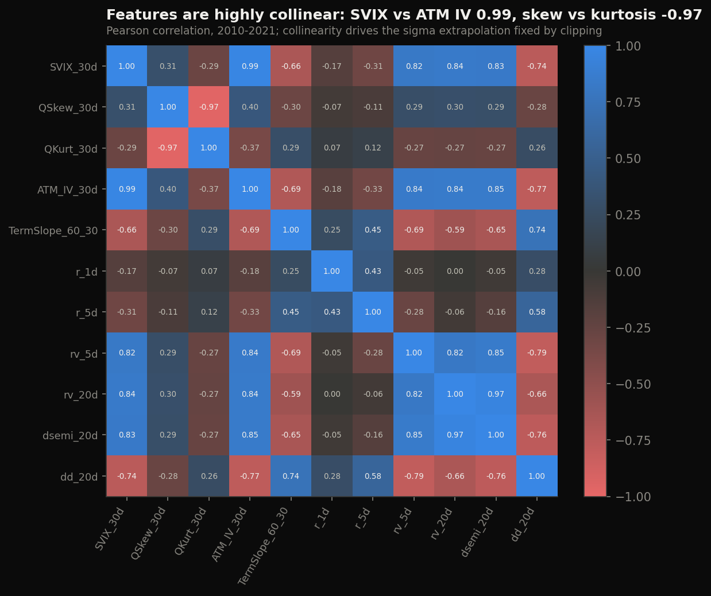</p>

## 9. Data integrity and leakage controls

| Control | Implemented and verified | Evidence | Residual risk |
|---|---|---|---|
| X uses only closes ≤ $t$ | yes; recomputation matches to 1e-16 | `historical_state.py` L97–118 | none found |
| Q uses only quotes dated $t$ | yes | `pipeline.py` L85 | true snapshot time (16:00 vs 16:15) unverifiable |
| Label maturity $t\le\tau-2$ | yes | `build_refit_inputs` | none |
| Scalers fit on training rows only | yes ($t\le\tau-2$) | same | docs misdescribe the window as $t\le\tau$ |
| HMM emissions through $\tau$, filtered not smoothed | yes | `hmm_filter.py` `forward_filter`; causality test in `tests/test_hmm_filter.py` | emission standardisation uses mean/sd through $\tau$ (causal) |
| Partition-crossing targets nulled | yes in committed data | `stage7_target_alignment.py`; `scratch/correct_feature_datasets.py` | current `batch_feature_pipeline.py` alone would not null 2019-12-31 |
| Isolated option-gap forward-fill | **test only** (5 dates) | `extract_stage8_test_features.py` L246–259 | the protocol's rule was **not** applied to development/validation (9 validation gaps left as missing), an asymmetry |
| No silent rate imputation | partially | committed CSVs flag two carry-forward dates | the original `cee01a1` script silently used r = 0.015; the 2016-11-11 moments were patched with hard-coded values, and QKurt_30d and ATM_IV_60d on that date were **not** recomputed |
| Test bundles unopened until Gate D | **not verifiable** from the repository | disclosure text only | n/a |
| Test-period exposure | disclosed | `cee01a1` committed the 2022-01-03/04 ^GSPC closes; the same script also downloaded ^IRX to 2022-01-05 (**not mentioned in the original disclosures**) | the test period cannot be called untouched |

**The 2022-01-03 rule.**
- The pre-registered (UD-4) intent was to exclude the exposed Jan 3→Jan 4 return. Under Proposal A that return is the target of origin 2021-12-31, which is nulled anyway.
- What was actually done was to exclude **origin** 2022-01-03 from scoring (primary N = 500).
- In the primary run its matured label still enters later refits. Only the **strict-isolation** sensitivity also drops it from training.
- The **actual-quote** subset (N = 495) additionally drops the 5 forward-filled dates from scoring, though their labels still enter later refits.

---

# PART III — Architecture and mathematical formulation

## 10. System architecture

### 10.1 Directory and module map
```
option-regimes/
├── src/features/                     # feature engineering (needs licensed raw chains)
│   ├── options_cleaning.py           # clean_options_chain, invert_synthetic_forward, screen_otm_quotes
│   ├── options_moments.py            # compute_martin_svix, compute_bkm_moments, invert_black76_iv,
│   │                                 #   compute_tenor_moments, interpolate_constant_maturity
│   ├── historical_state.py           # fetch_historical_spx_closes, compute_historical_features
│   ├── pipeline.py                   # per-date Stage 4 pipeline (process_date)
│   └── stage7_target_alignment.py    # align_stage7_datasets: Proposal A target + validity flags
├── src/models/                       # modelling and evaluation (runs on committed CSVs)
│   ├── density_models.py             # RobustFeatureScaler, B0 ModelB0_UnconditionalGaussian,
│   │                                 #   B1 ModelB1_RVLocationScaleStudentT, StudentTRegression (B2-B4, R1),
│   │                                 #   MixtureDensityNetwork2 (exploratory); _run_lbfgs, _newton_polish
│   ├── hmm_filter.py                 # CausalGaussianHMM: Baum-Welch fit, forward_filter, diagnostics
│   ├── walk_forward_pipeline.py      # build_refit_inputs, build_scoring_inputs, run_walk_forward
│   ├── evaluation_metrics.py         # NLL, CRPS, PIT, coverage, pinball, DM/HAC, stationary bootstrap
│   ├── paired_comparisons.py         # summarize_differential, run_comparisons, stress_mask   (revision)
│   ├── recalibration.py              # prequential_scale_recalibration                         (revision)
│   └── garch_benchmark.py            # gjr_t_forecasts (arch)                                   (revision)
├── tests/                            # 35 pytest tests (revision)
├── scratch/                          # experiment runners, audits, feature batch scripts
├── output/stage{4,6}_features, stage6_audit, stage7_datasets, stage8_test   # original record
├── output/stage7_models/                                                    # original Stage 7 results
├── output/stage7_models_v2/, output/stage8_test_v2/                         # revision results + protocols
├── figures/, figures/gifs/           # generated by scratch/make_figures.py from committed results
└── docs/                             # protocol, specs, audits, gate reports, literature, this report
```

### 10.2 Data and component flow
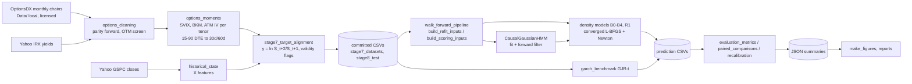

### 10.3 End-to-end algorithm (as implemented in `run_walk_forward`)
```
input: sessions 0..N-1 with Q, X, y, validity flags; first scored index v0; lambda; K
for each refit origin tau in {v0-1, v0-1+21, ...}:
    scoring window W = [max(v0, tau+1), min(N, tau+22))
    HMM: standardise (r_1d, rv_20d) with mean/sd over [0, tau]; Baum-Welch on [0, tau];
         forward-filter through max(W)                 # parameters frozen, recursion causal
    supervised rows T = {t <= tau-2 : valid_supervised_pair_all5}
    fit RobustFeatureScaler on Q[T] and X[T] separately; optional clip bounds = training quantiles
    fit B0 (closed form), B1 (rv_20d), B2 (Q), B3 (X), B4 (Q,X), R1 (Q,X,pi) on T   # converged optimiser
    for t in W: scale (and optionally clip) inputs with the frozen scalers;
                record mu_t, sigma_t, nu and log p_t(y_t) for every model
evaluate on the scored valid rows: NLL, CRPS, PIT/KS, coverage, pinball; paired DM + bootstrap
```

### 10.4 Script to output trace
| Script | Generation | Main outputs |
|---|---|---|
| `scratch/run_stage7_experiments.py` | original (at `66924f3`) | `output/stage7_models/*` (grid, metrics, predictions, HMM and sensitivity diagnostics) |
| `scratch/run_stage8_test_evaluation.py` | original (at `67a9642`) | `output/stage8_test/test_*`, `hmm_refit_diagnostics_test.json` |
| `scratch/check_step1_fit_diagnostics.py` | revision Step 1 | console check: original predictions reproduced to 3.6e-15 |
| `scratch/check_step3_convergence.py` | Step 3 | `output/stage7_models_v2/step3_convergence_check.json` |
| `scratch/check_step4_hmm_b1_b0.py` | Step 4 | `.../step4_hmm_b1_b0_check.json` |
| `scratch/run_stage7_v2_validation.py` | Step 5 | `.../lambda_grid_K2_v2.json`, `validation_predictions_primary_v2.csv`, `validation_metrics_summary_v2.json`, `refit_diagnostics_primary_v2.json`, `paired_comparisons_v2.json` |
| `scratch/run_step6_sigma_controls.py` | Step 6 | `.../step6_sigma_controls.json`, `step6_predictions_*.csv` |
| `scratch/run_step7_width_controlled.py` | Step 7 | `.../step7_width_controlled.json` |
| `scratch/run_benchmark_gjr_validation.py` | benchmark | `.../benchmark_gjr_validation.json`, `benchmark_gjr_predictions_validation.csv` |
| `scratch/run_stage8_v2_test_rescore.py` | Step 8 (post-hoc) | `output/stage8_test_v2/test_rescore_v2.json`, `test_predictions_{clipped,clipped_strict,unclipped}.csv` |
| `scratch/run_benchmark_gjr_test.py` | Step 8 addendum (post-hoc) | `.../benchmark_gjr_test.json`, `benchmark_gjr_predictions_test.csv` |
| `scratch/make_figures.py` | reporting | `figures/*.png`, `figures/gifs/*.gif` |

**Core vs research code.** `src/models/` and `src/features/` are the reusable core, and `tests/` covers `src/models/`. `scratch/` holds experiment runners and one-off audits. Two duplications matter. First, `scratch/run_stage8_test_evaluation.py` re-implements the walk-forward loop instead of calling `run_walk_forward`; the revised test runner does reuse it. Second, the feature batch scripts duplicate `src/features/pipeline.py`. The committed development/validation feature CSVs were produced by the **original** version of `scratch/batch_feature_pipeline.py` plus `scratch/correct_feature_datasets.py`, not by the current version of the batch script; the committed files contain a `status_X` column that only the original version writes.

## 11. Predictive-density models

**Notation.** $x_t$ is the robust-scaled input vector, $t_\nu$ is the Student-t density, and $\ell_t=\log p_t(y_t)$.

**Student-t log density** (`_student_t_log_lik` in `src/models/density_models.py`):

$$\log p(y\mid\mu,\sigma,\nu)=\log\Gamma\!\Big(\frac{\nu+1}{2}\Big)-\log\Gamma\!\Big(\frac{\nu}{2}\Big)-\frac12\log(\pi\nu)-\log\sigma-\frac{\nu+1}{2}\log\!\Big(1+\frac{(y-\mu)^2}{\nu\sigma^2}\Big).$$

`tests/test_density_models.py` checks this against `scipy.stats.t.logpdf` to 1e-12.

| Model | Inputs ($d$) | Density | Parameters | Objective | Constraints and initialisation | Role |
|---|---|---|---|---|---|---|
| **B0** | none | $\mathcal N(\hat\mu,\hat\sigma^2)$, expanding sample mean and SD (ddof = 1) | 2 | closed form | $\sigma\ge10^{-4}$ | naive floor |
| **B1** | $\mathrm{RV}_{20}$, raw | $t_\nu$, constant $\mu$, $\sigma_t=a_0+a_1\mathrm{RV}_{20,t}$ | 4 | mean NLL, **no penalty** | $a_0=\mathrm{sp}(p_0)+10^{-4}$, $a_1=\mathrm{sp}(p_1)$, $\nu=\mathrm{sp}(p_\nu)+2.1$; init $\mu=\bar y$, $a_0=0.5\,\mathrm{sd}(y)$, $a_1=0.05$, $\nu=5$ | simple P-volatility baseline |
| **B2** | Q (5) | $t_\nu$, $\mu_t=b_\mu+x_t^\top w_\mu$, $\sigma_t=\mathrm{sp}(b_\sigma+x_t^\top w_\sigma)+10^{-4}$, constant $\nu=\mathrm{sp}(\rho)+2.1$ | 13 | $-\frac1n\sum_t\ell_t+\lambda(\lVert w_\mu\rVert^2+\lVert w_\sigma\rVert^2)$ | init $w=0$, $b_\mu=\bar y$, $b_\sigma=\mathrm{sp}^{-1}(\mathrm{sd}\,y)$, $\rho=2.85$ ($\nu\approx5.006$) | options only |
| **B3** | X (6) | same | 15 | same | same | history only |
| **B4** | Q + X (11) | same | 25 | same | same | primary non-regime model |
| **R1** | Q + X + $(\pi_0,\pi_1)$ (13) | same | 29 | same | same | regime challenger |

Here sp is softplus. **Only the slope weights are penalised**; the intercepts $b_\mu,b_\sigma$ and the degrees-of-freedom parameter are not (`StudentTRegression.penalty`, verified in code). ν is a single scalar per fit, never a function of inputs. The objective is the **mean** NLL plus the penalty, so λ acts on a per-observation scale.

**Exploratory model.** `MixtureDensityNetwork2`, a two-component Student-t mixture, was evaluated once on validation in the original Stage 7 run: it improved NLL by 0.027 nats (`output/stage7_models/validation_metrics_summary.json` `/mdn_check`). It was then dropped and is not part of any revised result. It still uses the original float32 single-step optimiser.

## 12. HMM architecture (`src/models/hmm_filter.py`)

**Model.** There is a latent state $z_t\in\{1,\dots,K\}$; K = 2 was frozen after the original Stage 7 found K = 3 failed the pre-registered improvement threshold of 0.020 nats. The other components are:
- transition matrix $A$;
- initial distribution $\rho$;
- diagonal Gaussian emissions $e_t\mid z_t=k\sim\mathcal N(m_k,\mathrm{diag}(v_k))$ on $e_t=[\tilde r_{1d},\widetilde{\mathrm{RV}}_{20}]$, each standardised by its mean and SD over $[0,\tau]$.

**Estimation (Baum–Welch).** Initialisation:
- means and variances come from volatility-quantile bins;
- $A_{kk}=0.95$;
- $\rho$ is uniform.

Each iteration then runs:
- **E-step:** scaled forward–backward on row-max-shifted emission likelihoods $B_{tk}=\exp(\log b_{tk}-\max_j\log b_{tj})$, giving $\alpha,\beta,\gamma,\xi$.
- **M-step:** update $A$, $m_k$ and $v_k$, with a variance floor of $10^{-4}$.

Two implementation details matter:
- **$\rho$ is never re-estimated, and there is a single deterministic start.** Both are logged as follow-ups.
- **The convergence monitor was wrong.** The original monitor used $\sum_t\log c_t$, the log-likelihood of the *shifted* emissions. It omits $\sum_t\max_k\log b_{tk}$, which changes with the parameters. The revision monitors the true log-likelihood $\log p(e_{0:T})=\sum_t\log c_t+\sum_t\max_k\log b_{tk}$ and records `n_iter_`, `converged_` and `log_lik_history_`. The stopping rule is $|\Delta\mathrm{LL}|<10^{-4}$ within at most 60 iterations.

`tests/test_hmm_filter.py` verifies three things:
- the monitored value equals an independent log-space forward recursion;
- EM's log-likelihood is non-decreasing;
- the filter is causal (a prefix gives identical probabilities).

**Filtering.** With parameters frozen at refit $\tau$, the forward recursion is

$$\pi_{t\mid t}(k)\;\propto\;b_k(e_t)\sum_j\pi_{t-1\mid t-1}(j)\,A_{jk}.$$

It runs through the scoring block. States are relabelled so that state 1 has the higher mean RV. **Filtered** probabilities are used, not smoothed ones and not a full-sample Viterbi path, because smoothing would use future emissions and leak information into $\pi_t$.

**How π enters R1.** R1 appends both $\pi_{0,t}$ and $\pi_{1,t}$, unscaled, to B4's scaled inputs. Since $\pi_0+\pi_1=1$, the design is **exactly singular** with respect to the intercept, and only the ridge penalty identifies the split. Appendix C measures this: R1's smallest Hessian eigenvalue in preconditioned coordinates is $1.05\times10^{-6}$. Revision Step 6 ran a π₁-only variant: it changes R1's log scores by at most 1.2e-3 and its NLL by 1e-5. So the singularity affects identification but not the forecasts.

**Overlap with X.** The emissions (daily return and RV₂₀) are themselves X features, so $\pi_t$ is a nonlinear filter of information B4 already has. This is the main reason to expect R1 ≈ B4.

**Effect of the monitor fix.** On the 25 validation refits the fixed monitor converges in 18–35 iterations. HMM parameters change by at most $|\Delta A|=1.1\times10^{-5}$ and π on scored rows by at most $4.3\times10^{-4}$ (`output/stage7_models_v2/step4_hmm_b1_b0_check.json`). So the original regime probabilities were essentially right.

## 13. GJR-GARCH benchmark (`src/models/garch_benchmark.py`)

$$r_t=\mu+\varepsilon_t,\qquad \varepsilon_t=\sqrt{h_t}\,z_t,\qquad z_t\sim t_\nu^{\text{std}},\qquad h_t=\omega+\big(\alpha+\gamma\,\mathbb 1[\varepsilon_{t-1}<0]\big)\varepsilon_{t-1}^2+\beta h_{t-1}.$$

- **Fitting.** Python `arch` 8.0.0, returns in percent, maximum likelihood on $r_0,\dots,r_\tau$ only (`last_obs = tau+1`), at the same 21-session refit origins as the regressions.
- **Horizon alignment.** The target at origin $t$ is $y_t=r_{t+2}$. With information through $r_t$ and parameters frozen at $\tau$, the forecast is $h_{t+1\mid t}=\omega+(\alpha+\gamma\mathbb 1[\varepsilon_t<0])\varepsilon_t^2+\beta h_t$, then $h_{t+2\mid t}=\omega+(\alpha+\gamma/2+\beta)\,h_{t+1\mid t}$. The predictive density is Student-t with location $\mu$, degrees of freedom $\nu$ and scale $\sqrt{h_{t+2\mid t}(\nu-2)/\nu}$. A one-step forecast would target the wrong day.
- **Verification.** `tests/test_garch_benchmark.py` rebuilds $h$ with an independent recursion and matches `arch`'s two-step forecast to a relative $10^{-8}$. It also checks that perturbing post-$\tau$ returns leaves the parameters unchanged (no leakage).
- **Fitted values.** $\alpha\approx0$, $\gamma\approx0.33$, $\beta\approx0.81$, persistence $\alpha+\gamma/2+\beta\approx0.97$, $\nu\approx5.4$ (`figures/37_gjr_parameters.png`). All 25 validation and 24 test fits converged (`benchmark_gjr_*.json` `/fits`).

## 14. The optimizer-calibration investigation

### 14.1 The original procedure
At commit `66924f3`, `StudentTRegression.fit` built float32 `nn.Linear` layers. It ran **one** `torch.optim.LBFGS.step` with `max_iter = 60` (so `max_eval = 75`), `lr = 0.5` and a strong-Wolfe line search, with **no convergence check**. B1 used the same scheme.

### 14.2 Symptoms (Step 1, no change to behaviour)
A fit report was added that reconstructs torch's stop reason from the optimizer state. Rerunning the original validation configuration reproduced the saved predictions to **3.6e-15** (`scratch/check_step1_fit_diagnostics.py`), so the diagnostics describe exactly the fits behind the original record. **All 100 B2–R1 fits (25 refits × 4 models) stopped on `max_iter`**, with max|grad| between 1e-2 and 2. ν sat at 5.01–5.02, its starting value. B1 also stopped unconverged.

### 14.3 Diagnosis: ill-conditioning from the location block
Near an optimum, the curvature of the mean NLL with respect to a location parameter is approximately $\mathbb E[w_t x_t^2/\sigma_t^2]$, where $w_t=(\nu+1)/(\nu+z_t^2)$ is a Student-t weight of order 1. With $\sigma\approx\mathrm{sd}(y)\approx0.009$ this is of order $1/0.009^2\approx10^4$. Meanwhile:
- the σ-weights enter through $\log\sigma$, giving curvature of order 1;
- $\nu$ is weakly identified, with curvature of order $10^{-3}$.

Appendix C (a new, read-only computation for this report) recomputes the exact Hessian of B4's penalised objective at its optimum on the 2,231 development rows:

| Parameter block | Curvature, original coordinates θ |
|---|---|
| location intercept $H[b_\mu,b_\mu]$ | $2.7\times10^{4}$ |
| σ-weights (median diagonal) | 1.1 |
| raw ν | $1.7\times10^{-3}$ |
| **condition number** | **$1.68\times10^{8}$** (B2: $1.6\times10^8$; R1: $1.85\times10^8$) |

This independently reproduces the ~1.7×10⁸ estimate from the original optimizer audit. A quasi-Newton method started at the identity, with 60 iterations in float32, cannot traverse such a valley. It stops while progress along the flat directions (ν, then σ) is still large. This is why ν never moved and why the more richly parameterised models (B4, R1) were the least converged.

### 14.4 Consequences for inference
- **Nesting violated.** At the original fits the in-sample development objectives were B4 −3.4730 vs B2 −3.4849 (Step 1 fit reports, recorded in the Step 2 commit message `779ee45`). B4 nests B2 (zero weights on X), so at true optima B4 ≤ B2 must hold. The converged values are B4 −3.4977 ≤ B2 −3.4923 ≤ B3 −3.4816 (Appendix C; `figures/13_nesting_restored.png`).
- **Unequal optimisation error biases comparisons.** Models end at different distances from their optima, so paired differences mix the information effect with the optimisation shortfall. The original R1-vs-B4 edge was partly B4 being less converged.
- **λ selection.** With unconverged fits, λ = 0.01 had the lowest B4 validation NLL. With converged fits, λ = 0.01 is the **worst** of the three and $10^{-4}$ is selected (`output/stage7_models_v2/lambda_grid_K2_v2.json`).

### 14.5 The fix (Step 3: `StudentTRegression.fit`, `_run_lbfgs`, `_newton_polish`)
1. **float64** throughout.
2. **Preconditioning.** Optimise $\phi_\mu=\theta_\mu/s$ with $s=\mathrm{sd}(y_{\text{train}})$. This rescales the location block's curvature by $s^2$. The model and objective are identical; only the coordinates change. In φ-coordinates B4's condition number drops to $1.3\times10^4$ (Appendix C).
3. **Chunked L-BFGS.** Strong-Wolfe line search, `lr = 1`, `history_size = 100`, at most 100 iterations per chunk and 2,000 in total. Stopping tolerances are max|grad| ≤ 1e-8, or objective/step change ≤ 1e-15·max(1,|f₀|), which is the float64 round-off floor.
4. **Exact-Hessian damped Newton polish** after each chunk. The Hessian of up to 29 parameters comes from double back-propagation.
   - A Newton step is attempted only if the Cholesky factorisation succeeds, i.e. the Hessian is positive definite.
   - The step is halved up to 30 times. It is accepted on an Armijo decrease ($c=10^{-4}$), or, at the round-off floor, if the objective stays within 1e-14·max(1,|f|) while max|grad| decreases.
   - Otherwise the parameters are left unchanged.
5. **Convergence certificate.** A fit counts as converged iff max|grad| ≤ 1e-8 **and** the Hessian is positive definite (a strict local minimum). Otherwise it is flagged and a `RuntimeWarning` is raised.

Two design facts were established empirically while developing the fix:
- A short L-BFGS memory was much *worse*: with history 10, R1 hit the 2,000-iteration cap.
- Chunking plus Newton is needed for **R1**. Preconditioning shrinks R1's singular π-intercept direction to curvature of about $10^{-6}$, along which L-BFGS crawls; one Newton step resolves it.

### 14.6 Acceptance evidence (`output/stage7_models_v2/step3_convergence_check.json`)
These checks cover the in-sample development fit and six representative validation refits, for B2, B3, B4 and R1 (28 fits):

| Check | Result |
|---|---|
| all fits converged (max\|grad\| ≤ 1e-8, Hessian positive definite) | yes |
| objective gap to an **independent** SciPy L-BFGS-B float64 optimum (`tests/reference_optimizer.py`, analytic gradient) | ≤ **8.1e-14** |
| per-row log score vs that reference | ≤ 2.3e-7 (the reference's own tolerance) |
| 3 natural-scale random starts: max \|Δ log p\| | **4.6e-13** |
| optimizer share of the one-label-deletion perturbation | ≤ 6.4e-7 |
| B4 ν across refits | 5.52–5.79 (moved off the 5.0 start) |

The audit's heuristic "one-label perturbation within 3× of B0" is **reported, not gated**. Ratios reach 7.9, but the optimizer's share is ≤ 6.4e-7, so the remainder is genuine statistical influence of a 25-parameter model.

Unit tests (`tests/test_density_models.py`) check:
- gradient vs finite differences in float64;
- the objective vs the reference implementation;
- the preconditioned objective equals the module objective;
- that non-convergence is flagged;
- that Newton completes a truncated L-BFGS run;
- the ν floor;
- nesting at the reference optimum.

**B1 (Step 4).** The same optimiser is applied with μ preconditioned. B1 now matches its own SciPy reference (`b1_reference_optimum`) to $10^{-12}$, and ν moves from the stuck 5.02 to 3.77–3.99.

**Provenance note.** The pre-fix per-refit optimisation gaps shown in `figures/09_convergence_gap.png` (about $10^{-3}$–$4\times10^{-2}$ nats) come from the external optimizer-audit notes. Those notes are not committed to the repository, and the figure script hard-codes their values. The post-fix gaps in the same figure come from the committed `step3_convergence_check.json`. The 100% `max_iter` stop rate and the nesting violation are independently reproducible from the repository (Step 1 script; Appendix C).

### 14.7 What changed scientifically
| Quantity | Original (O-VAL / O-TEST) | Converged (R-VALU / R-VAL / R-TEST) |
|---|---|---|
| selected λ | 0.01 | $10^{-4}$ |
| ν (B4) | ≈ 5.01 (initial value) | 5.52–5.79 |
| R1 − B4, validation | +0.0056 (p 0.23) | −0.0081 (p 0.90) unclipped; −0.0040 (p 0.83) clipped |
| Q1 = B4 − B3, validation | +0.0283 (p 0.145) | +0.0538 (p 0.004) unclipped; +0.0328 (p 0.020) clipped |
| PIT/KS on validation (B4, R1) | reject (p 0.011, 0.018) | pass (p 0.075, 0.052, clipped) |
| B0 PIT/KS on validation | p 0.044 (bug: row-0 parameters) | p 0.0017 (per-row) |

(Sources: Appendix B; `paired_comparisons_v2.json`; `step6_sigma_controls.json`.)

<p align="center">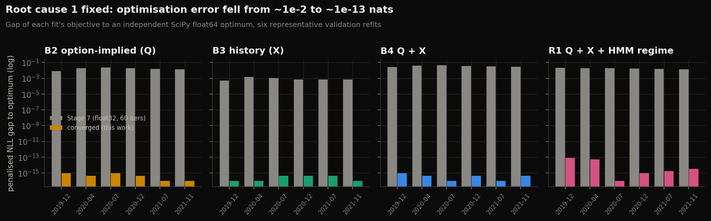</p>
<p align="center">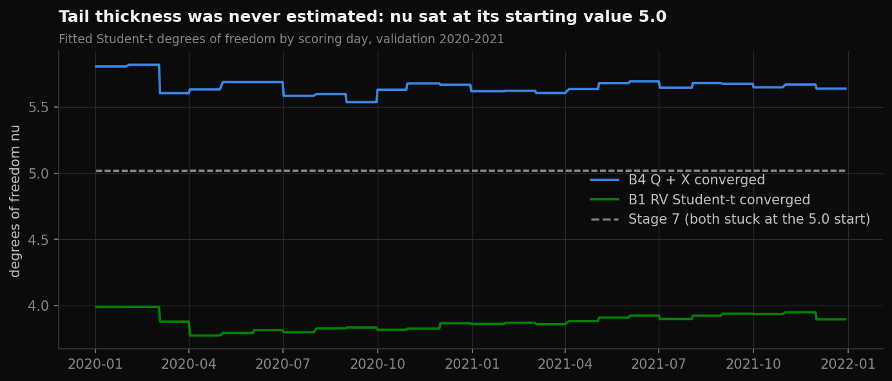 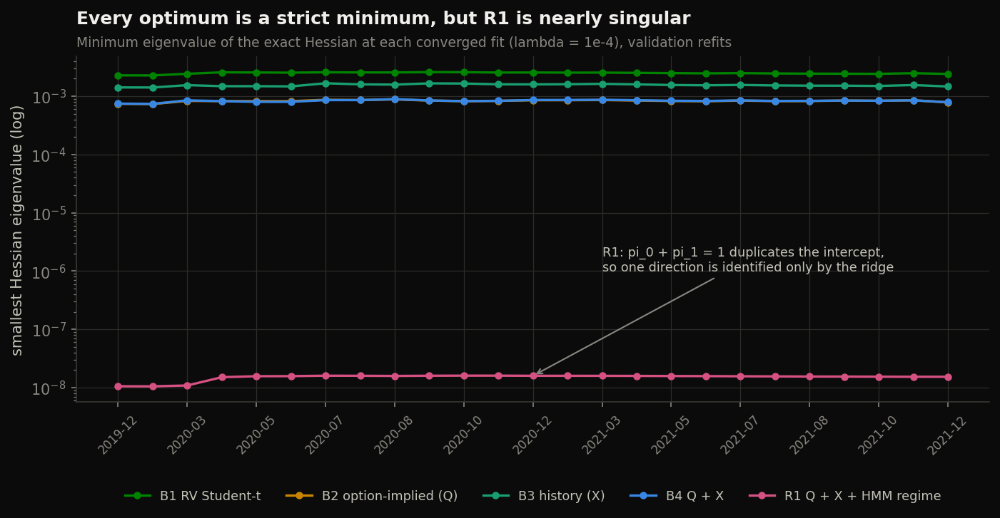</p>

*Figure 09: per-refit penalised-objective gap to the float64 optimum (log scale), before (grey; audit values) and after (colour; committed). Figure 10: fitted ν by validation day; the original values sit on the 5.0 initialisation. Figure 12: smallest exact-Hessian eigenvalue per converged refit. All are positive (strict minima), and R1 is near-singular because of the π-intercept collinearity.*

## 15. Extreme-scale behaviour and clipping (Step 6)

**Problem.** The scale equation is softplus-linear in robust z-scores. In March 2020 the collinear volatility features reached 10–16 robust z, beyond anything in training (maxima about 5–9). Because softplus is linear for large arguments, predicted **daily** σ became absurd. In the unclipped converged fits the maxima are **B3 1.82, B4 0.73, R1 0.72, B2 0.51**: daily standard deviations of 51–182% (Appendix B, R-VALU; `figures/15_sigma_blowup_march_2020.png`). The original pipeline had the same issue (O-VAL maxima: B3 1.73, R1 0.68). The original Gate C stability check tested only positivity and integrability, so it accepted these values.

**Pre-declared control** (`output/stage7_models_v2/step6_decision_rule.md`, committed before any run):
- At **scoring time only**, clip each scaled Q and X feature to the [0.5%, 99.5%] quantiles of that feature in the refit's own training rows. Training rows and π are not clipped.
- **Adopt** only if both conditions hold:
  1. max daily σ over Mar–Apr 2020 < 0.10 for every affected model;
  2. no model among B2, B3 and B4 worsens by more than 0.005 nats, and none shows a significant DM worsening at 5%.
- A collinearity-reduction variant was to be run only if clipping failed criterion 1. It did not fail, so the variant was not run.

**Result** (`step6_sigma_controls.json`). Max σ fell to B2 0.054, B3 0.063, B4 0.050 and R1 0.046. NLL **improved** by 0.031 (B2), 0.051 (B3) and 0.030 (B4). The control was **adopted**. Models the control should not touch reproduced the baseline to below $10^{-10}$.

**Limitations.** Clipping is a modelling intervention against out-of-support extrapolation. It is not evidence that a linear-in-features scale is correctly specified. It also changes the comparison: clipping helps B3 (history) more than B4, which is why Q1 shrinks from +0.054 (unclipped) to +0.033 (clipped).

<p align="center">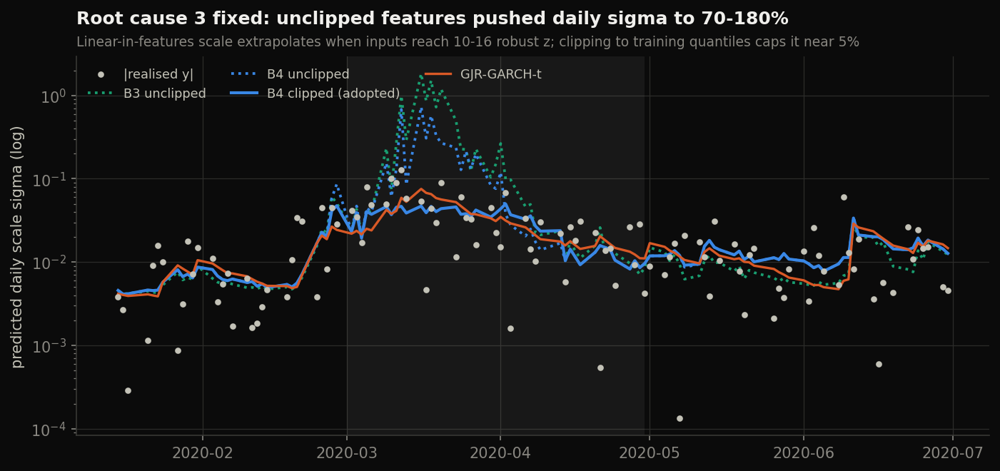</p>

*Figure 15: predicted daily σ (log scale), January–June 2020, for unclipped B3 and B4, clipped B4 and GJR-GARCH, with |realised y| as dots.*

---

# PART IV — Experiment design, statistics and reproducibility

## 16. Walk-forward evaluation engine

```
   development 2010-01-04 ... 2019-12-31 | validation 2020-2021 (494 scored) | test 2022-2023 (500 primary)
   ───────────────────────────────────────┼───────────────────────────────────┼────────────────────────────
   refit τ0 = last 2019 session: train on t ≤ τ0-2 ──► score τ0+1 … τ0+21
   refit τ1 = τ0+21:            train on t ≤ τ1-2 ──► score τ1+1 … τ1+21          (expanding window)
   ...
   test refits start at the last 2021 session and train on all matured dev + validation (+ test) labels
```

- **Refit cadence.** Every 21 sessions, on an expanding window from 2010-01-04: 25 validation refits (the last scores no valid row) and 24 test refits.
- **At each refit.**
  - HMM fitted on emissions through $\tau$, then forward-filtered through the block.
  - Scalers and models fitted on matured rows ($t\le\tau-2$).
  - Every model scores the same origins.
- **Model selection.** λ was chosen on validation by the Stage 7 rule (minimum B4 validation NLL). K was fixed at 2 by the original Gate C rule. The clipping control was adopted by the pre-declared Step 6 rule. No choice was made on test data.
- **Validation is prequential, not a static hold-out.** Matured validation labels enter later validation refits, and validation also informed tuning. This was already a Gate C caveat.
- **Duplicated code paths.** The original test runner duplicated the loop; the revised runner reuses `run_walk_forward` with `val_start_idx` set to the first test session. Revised validation and test therefore share one code path, so they are directly comparable.

## 17. Evaluation metrics and inference (`src/models/evaluation_metrics.py`, `paired_comparisons.py`)

| Metric | Definition | Direction |
|---|---|---|
| NLL | $-\frac1N\sum_t\log p_t(y_t)$ | lower is better |
| CRPS | $\int(F_t(u)-\mathbb 1[y_t\le u])^2du$; closed form for Gaussian and Student-t | lower is better |
| PIT | $u_t=F_t(y_t)$; KS test vs U(0,1) | uniform means calibrated |
| Coverage | share of $y_t$ inside central 50/80/95% intervals | equal to nominal |
| Pinball | $\rho_\alpha(y-q_\alpha)$ for α ∈ {0.01, 0.05, 0.10, 0.90, 0.95, 0.99} | lower is better |
| Paired differential | $d_t=\log p_A(y_t)-\log p_B(y_t)$, $\bar d=\mathrm{NLL}_B-\mathrm{NLL}_A$ | **positive favours A** |

**Inference.**
- **Diebold–Mariano.** $\mathrm{DM}=\bar d/\sqrt{\widehat{\mathrm{LRV}}/N}$, where $\widehat{\mathrm{LRV}}=\hat\gamma_0+2\sum_{l=1}^{L}(1-\frac{l}{L+1})\hat\gamma_l$ (Newey–West, Bartlett kernel). One-sided p-value is $1-\Phi(\mathrm{DM})$; two-sided is also reported. Lags are 5 (primary; equal to the automatic rule at N ≈ 500), 10 and 21.
- **Stationary block bootstrap** (Politis–Romano). 2,000 replications, mean block length 5, seed 42, percentile 95% interval.
- **Prequential recalibration** (revision, `recalibration.py`). For each block $b$, $c_b=\arg\max_{c\in[0.25,4]}\sum_{s\le\tau_b-2}\log f(y_s;\mu_s,c\,\sigma_s,\nu_s)$ over previously scored rows; $c_b=1$ if fewer than 21 rows are eligible. Its tests check recovery of a known inflation and **no leakage** (later outcomes cannot change earlier $c_b$).

**Caveats.**
- The DM asymptotics assume covariance stationarity of $d_t$, which volatility shocks strain.
- A confidence interval that spans zero is not evidence of equality.
- Ordinary KS p-values on PIT assume independence. Dependence makes them approximate, and they lose power for tail-specific miscalibration.
- Differences of about 0.01 nats/session are small relative to the cross-sectional SD of $d_t$.

**Known metric bug (fixed).** The original pipeline computed B0's PIT with `mu[0], sigma[0]` for every row. The original validation KS p of 0.044 is actually **0.0017**, and on the test N = 500 sample 0.321 is actually **0.3905** (Appendix B; `step4_hmm_b1_b0_check.json`).

**Analysis tiers (kept distinct throughout).**
- **In-sample:** development fit.
- **Sequential validation:** prequential, informs tuning.
- **Original Gate D test:** scored once.
- **Revised post-hoc test:** 2022–2023 rescored twice more, under committed protocols.

## 18. Tests and software reliability (`tests/`)

| File | Verifies |
|---|---|
| `test_density_models.py` | Student-t log density and penalised objective vs SciPy/NumPy (1e-12); autograd vs central finite differences (float64); σ ≥ σ_min and ν ≥ 2.1 under extreme inputs; synthetic parameter recovery; determinism; fit-report fields; **reaching the independent reference optimum**; **nesting** (B4 ≤ B2, B3); preconditioning invariance; non-convergence is flagged; Newton completes a truncated L-BFGS run; B1 gradient and reference optimum; B0 closed form; **B0 PIT uses per-row parameters** |
| `test_hmm_filter.py` | monitored log-likelihood equals independent log-space forward; EM monotonicity; filter equals log-space filter and is causal; volatility ordering |
| `test_paired_comparisons.py` | exact per-block means, HAC lag handling, stress mask, sign convention |
| `test_recalibration.py` | scale recovery (t and Gaussian); only matured past rows used; recalibrated density uses $c\sigma$ |
| `test_walk_forward_controls.py` | default design reproduces the primary design exactly; clipping uses training quantiles and leaves training rows unclipped; Q-subset and π-state options; π ablations (permutation-only, training-median threshold) |
| `test_garch_benchmark.py` | two-step forecast equals an independent GJR recursion; no leakage past τ |
| `reference_optimizer.py` | independent SciPy float64 objective and analytic gradient for the regression and B1 (support module) |

**Recorded result:** 35 tests passed on the final code. The run was recorded during the revision with convergence warnings promoted to errors (`-W error::RuntimeWarning`); see the commit messages on this branch. It was not re-run for this report.

**Gaps.**
- No tests for the feature-engineering code (it needs licensed data).
- No tests for `MixtureDensityNetwork2`.
- No test pins the original Stage 7 numbers; checking them needs the original commit.

**Scope.** Passing tests establish numerical and implementation correctness, **not** the economic hypothesis.

## 19. Reproducibility guide

**Environment.** Python 3.13 (the bytecode in `src/__pycache__` is cpython-313) with numpy, scipy, pandas, torch, arch 8.0.0, matplotlib and pytest. Versions are not pinned and there is no lock file. Raw-data feature construction additionally needs the licensed OptionsDX files and network access to Yahoo.

| Command (from the repository root) | Inputs | Outputs | Overwrites? | Cost |
|---|---|---|---|---|
| `python -m pytest tests` | committed CSVs | none | no | ~2 min |
| `python scratch/check_step1_fit_diagnostics.py` | committed CSVs | console | no | ~10 min. **On the current branch this compares converged fits to the original predictions, so it now reports differences.** It verifies only at commit `029c16d`. |
| `python scratch/check_step3_convergence.py` | committed CSVs | `output/stage7_models_v2/step3_convergence_check.json` | yes (same content) | ~10 min |
| `python scratch/run_stage7_v2_validation.py` | committed CSVs | `output/stage7_models_v2/*` (Step 5 files) | yes | ~15 min |
| `python scratch/run_step6_sigma_controls.py` | Step 5 outputs | `step6_*` | yes | ~15 min |
| `python scratch/run_step7_width_controlled.py` | Step 5 and Step 6 outputs | `step7_width_controlled.json` | yes | ~15 min; needs about 2 GB free RAM |
| `python scratch/run_benchmark_gjr_validation.py` | committed CSVs | `benchmark_gjr_*validation*` | yes | ~3 min |
| `python scratch/make_figures.py [--png-only]` | committed results | `figures/` | yes | ~10 min (PNG ~2 min) |
| `python docs/report_appendices/compute_report_statistics.py` | committed predictions | `docs/report_appendices/detailed_statistics.md` | appendix only | ~1 min |
| `python docs/report_appendices/compute_conditioning.py` | committed development CSV | `docs/report_appendices/conditioning.md` | appendix only | ~1 min |

**Warnings.**
1. **Re-running the test-period scripts** (`run_stage8_v2_test_rescore.py`, `run_benchmark_gjr_test.py`) is another look at 2022–2023. Any new use of that period is a further post-hoc analysis.
2. **Re-running the original scripts** (`run_stage7_experiments.py`, `run_stage8_test_evaluation.py`) on this branch imports the *revised* `src/models/`. That would **overwrite the original record** in `output/stage7_models/` and `output/stage8_test/` with different numbers. To reproduce the original, check out `66924f3` (Stage 7) or `67a9642` (Gate D).
3. `docs/reproducibility_guide.md` lists five source files that never existed in history (`src/data/*.py`, `src/features/svix.py`, `src/features/moments.py`) and uses absolute `file:///D:/IE612_Project/...` links. Treat it as historical.
4. Full reproducibility from raw data is **not** possible without the licensed files. All modelling results are reproducible from the committed CSVs.

---

# PART V — Results and interpretation

## 20. Experiment inventory (summary; the full inventory with commits is in Appendix A)

| ID | Experiment | Partition | Status | Key artifact |
|---|---|---|---|---|
| E1 | Feature construction and audits (Stages 3–6, Gate B) | 2010–2021 | pre-specified with user-authorised deviations | `output/stage6_*`, `docs/gate_b_audit_report.md` |
| E2 | Original λ × K grid, primary run, MDN check, mid-2012 sensitivity (Gate C) | validation | pre-specified tuning | `output/stage7_models/*` |
| E3 | Original Gate D test: N = 500 primary, strict isolation, N = 501, N = 495 | test | **pre-registered, scored once** (test partially exposed) | `output/stage8_test/test_metrics_summary.json` |
| E4 | Fit diagnostics on the original configuration (Step 1) | validation | audit | Step 1 script, commit `029c16d` |
| E5 | Convergence fix and reference-optimizer acceptance (Step 3) | dev + 6 validation refits | audit | `step3_convergence_check.json` |
| E6 | B1, B0-PIT and HMM fixes (Step 4) | validation | audit | `step4_hmm_b1_b0_check.json` |
| E7 | Converged validation run and λ grid (Step 5) | validation | development | `paired_comparisons_v2.json` |
| E8 | Clipping control, π₁-only (Step 6) | validation | **pre-declared rule** | `step6_sigma_controls.json` |
| E9 | Prequential recalibration and regime ablations (Step 7) | validation | **pre-declared specification** | `step7_width_controlled.json` |
| E10 | GJR-GARCH-t benchmark | validation | pre-declared specification | `benchmark_gjr_validation.json` |
| E11 | Revised test re-score: clipped, strict, unclipped; N = 500/501/495 | test | **post-hoc**, pre-declared Q1 rule | `test_rescore_v2.json` |
| E12 | GJR-GARCH-t on test | test | **post-hoc**, pre-declared addendum | `benchmark_gjr_test.json` |
| E13 | Statistics and conditioning recomputed for this report | all generations | new read-only analysis | Appendices B, C |

## 21. Results tables

### A. Original pipeline (O-VAL, O-TEST; unconverged; λ = 0.01)
Source: `output/stage7_models/validation_metrics_summary.json` and `output/stage8_test/test_metrics_summary.json`. The B0 PIT values are corrected per Appendix B.

| Model | O-VAL NLL (N = 494) | O-VAL CRPS | O-VAL PIT p | O-TEST NLL (N = 500) | O-TEST CRPS | O-TEST PIT p |
|---|---|---|---|---|---|---|
| B0 | −2.1245 | 0.007778 | 0.0017* | −2.9648 | 0.006743 | 0.3905* |
| B1 | −3.0636 | 0.007332 | 0.0170 | −3.0301 | 0.006678 | 0.0507 |
| B2 | −3.1188 | 0.007501 | 0.0265 | −3.0547 | 0.006629 | 0.0057 |
| B3 | −3.0837 | 0.010774 | 0.0782 | −3.0365 | 0.006687 | 0.0088 |
| B4 | −3.1120 | 0.007732 | 0.0109 | −3.0553 | 0.006616 | 0.0500 |
| R1 | −3.1176 | 0.007935 | 0.0176 | −3.0608 | 0.006609 | 0.0371 |

\* Corrected per-row values; the original reports give 0.044 and 0.321 because of the B0 PIT bug.

**Original primary result (H1, R1 vs B4).**
- O-VAL: $\bar d$ = +0.0056, DM 0.72, one-sided p = 0.235, CI [−0.0095, +0.0199].
- O-TEST N = 500: $\bar d$ = **+0.005417**, HAC SE 0.00373, DM 1.452, one-sided p = **0.0732**, two-sided p = 0.1465, CI [−0.00198, +0.01384].
- Strict isolation: +0.0055 (p 0.065). N = 501: +0.0073 (p 0.034, CI [−0.0005, +0.0154]). N = 495: +0.0054 (p 0.075).

**Verdict at the time:** inconclusive. B4 was favoured for parsimony.

### B. Optimizer calibration
See §14.6 and §14.7, and Appendix C.

### C. Revised validation (R-VAL clipped/adopted and R-VALU unclipped; λ = 1e-4; N = 494)
| Model | R-VAL NLL | CRPS | PIT p | cov 50/80/95 | max σ | R-VALU NLL | R-VALU max σ |
|---|---|---|---|---|---|---|---|
| B0 | −2.1245 | 0.007778 | 0.0017 | .545/.806/.905 | 0.011 | −2.1245 | 0.011 |
| B1 | −3.0741 | 0.007296 | 0.0266 | .449/.773/.931 | 0.037 | −3.0741 | 0.037 |
| B2 | −3.1622 | 0.007018 | **0.1178** | .478/.802/.957 | 0.054 | −3.1314 | 0.505 |
| B3 | −3.1294 | 0.007053 | 0.0104 | .415/.739/.931 | 0.063 | −3.0781 | 1.822 |
| B4 | **−3.1622** | **0.007006** | **0.0751** | .478/.804/.951 | 0.050 | −3.1319 | 0.728 |
| R1 | −3.1582 | 0.007022 | 0.0523 | .474/.794/.949 | 0.047 | −3.1239 | 0.715 |
| GJR | −3.1178 | 0.007086 | 0.0074 | .439/.765/.945 | 0.076 | −3.1178 | 0.076 |

### D. Revised post-hoc test (R-TEST; clipped; λ = 1e-4; N = 500)
| Model | NLL | CRPS | PIT p | cov 50/80/95 | max σ |
|---|---|---|---|---|---|
| B0 | −2.9648 | 0.006743 | 0.3905 | .508/.786/.916 | 0.011 |
| B1 | −3.0407 | 0.006644 | 0.1227 | .444/.742/.960 | 0.015 |
| B2 | **−3.0570** | 0.006622 | 0.0064 | .420/.746/.934 | 0.024 |
| B3 | −3.0371 | 0.006688 | 0.0123 | .440/.750/.932 | 0.038 |
| B4 | −3.0492 | 0.006637 | 0.0071 | .436/.734/.932 | 0.026 |
| R1 | −3.0568 | 0.006623 | 0.0088 | .440/.748/.928 | 0.026 |
| GJR | −3.0530 | **0.006616** | **0.0959** | .450/.730/.940 | 0.025 |

### E. Primary research comparisons by generation
Mean $d$ is in nats/session, followed by the one-sided DM p at lag 5, the 95% bootstrap CI, and blocks with $d>0$ out of the total. Full detail, including NLLs, HAC SEs, two-sided p and lags 10/21, is in Appendix B.

| Comparison | O-VAL | O-TEST (N = 500) | R-VAL (adopted) | R-TEST (post-hoc) |
|---|---|---|---|---|
| **Q1** B4 vs B3 | +0.0283, p .145, [−.020, +.088], 15/24 | +0.0189, p .033, [−.001, +.039], 15/24 | **+0.0328, p .020**, [+.003, +.063], 17/24 | +0.0121, **p .052**, [−.002, +.027], 14/24 |
| **Q2a** B2 vs B1 | +0.0552, p .063 | +0.0246, p .026, [+.001, +.050] | **+0.0880, p < .001**, [+.043, +.146] | +0.0163, p .090 |
| **Q2b** B2 vs B0 | see App. B | see App. B | see App. B | **+0.0922, p .001**, [+.033, +.151] |
| **Q3** B3 vs B1 | see App. B | see App. B | **+0.0553, p .021**, [+.005, +.117] | −0.0036, p .61 |
| **Regime** R1 vs B4 | +0.0056, p .235 | +0.0054, p .073 | −0.0040, p .83 | +0.0076, p .025, [−.0002, +.016] |
| **B4 vs GJR** | n/a | n/a | **+0.0445, p .010**, [+.010, +.084], 17/24 | −0.0038, p .645, [−.024, +.016], 11/24 |
| **B2 vs GJR** | n/a | n/a | **+0.0444, p .014** | +0.0040, p .353 |

### F. Calibration summary
- **Validation, converged and clipped:** B2, B4 and R1 pass KS at 5%; B0, B1, B3 and GJR fail. Coverage is close to nominal for B2, B4 and R1.
- **Test (post-hoc, N = 500):** B2, B3, B4 and R1 **fail** KS (p ≤ 0.013). Their 50% intervals cover only 42–44% of outcomes and their 80% intervals 73–75%, so they are **too narrow**. B1 (0.12), GJR (0.096) and B0 (0.39) pass.
- **Recalibration factors $c_b$** exceed 1 for most models after the 2020 shock (figure 34), which confirms general under-dispersion.

## 22. Detailed statistics for the primary comparisons

| Statistic | Q1 R-VAL | Q1 R-TEST | Regime O-TEST (orig. H1) | B4 vs GJR R-VAL | B4 vs GJR R-TEST |
|---|---|---|---|---|---|
| NLL A / NLL B | −3.16222 / −3.12941 | −3.04923 / −3.03711 | −3.06076 / −3.05534 | −3.16222 / −3.11775 | −3.04923 / −3.05298 |
| mean $d$ | +0.0328 | +0.0121 | +0.0054 | +0.0445 | −0.0038 |
| ΔCRPS (B − A) | +0.000046 | +0.000051 | +0.000007 | +0.000079 | −0.000021 |
| HAC SE (5 lags) | 0.01591 | 0.00745 | 0.00373 | 0.01899 | 0.01012 |
| DM statistic | 2.062 | 1.626 | 1.452 | 2.341 | −0.371 |
| p one-sided (5 / 10 / 21) | .0196 / .0162 / .0095 | .0520 / .0492 / .0265 | .0732 / .0937 / .1258 | .0096 / .0108 / .0078 | .6447 / .6501 / .6518 |
| p two-sided (5) | .0392 | .1039 | .1465 | .0192 | .7107 |
| bootstrap 95% CI | [+.0034, +.0629] | [−.0019, +.0273] | [−.0020, +.0138] | [+.0104, +.0836] | [−.0239, +.0156] |
| by year | 2020 +.0417, 2021 +.0237 | 2022 +.0184, 2023 +.0058 | 2022 +.0126, 2023 −.0018 | 2020 +.0466, 2021 +.0423 | 2022 −.0117, 2023 +.0042 |
| blocks $d>0$ | 17/24 | 14/24 | 10/24 | 17/24 | 11/24 |
| excluding Mar–Apr 2020 | +.0355 (p .019) | n/a | n/a | +.0507 (p .006) | n/a |
| after recalibration | +.0155 (p .095) | +.0174 (p .005) | n/a | +.0377 (p .010) | +.0020 (p .408) |
| strict isolation / N = 501 / N = 495 | n/a | +.0121 (p .055) / +.0105 (.082) / +.0104 (.079) | +.0055 (.065) / +.0073 (.034) / +.0054 (.075) | n/a | see `benchmark_gjr_test.json` |
| practical threshold ($\bar d\ge0.010$) | met | met but not significant | **not met** | met | not met |

Sources: Appendix B; recalibration rows from `step7_width_controlled.json` (validation) and `test_rescore_v2.json` / `benchmark_gjr_test.json` (test, primary-sample recalibration).

**Interpretation of magnitudes.** 0.033 nats/session means B4 assigns, on average, $e^{0.033}\approx1.034$ times the predictive density of B3 to the realised outcome, a 3.4% likelihood gain per day. This is a **forecast-accuracy** quantity, **not** a trading return.

**Sensitivity note.** In the revised test the *unclipped* configuration gives Q1 = +0.0124 with p = 0.049. That is below 0.05, but it is **not** the pre-declared configuration, so it does not change the primary decision (p = 0.052). It is reported only for transparency.

## 23. Benchmarks and ablations

**GJR-GARCH-t (E10, E12).** It uses the same refit origins and the same two-step target alignment, and it is fitted on returns only. On validation the option regressions beat it by about 0.044 nats/session (B4, B2), while the history-only regression does not (B3 +0.012, p 0.16). That gap survives recalibration (B4 +0.038, p 0.010). On test, GJR has the best CRPS and passes PIT, and the regressions tie it on log score. **What this establishes:** on validation, option information adds to what a standard asymmetric volatility model extracts from returns. **What it does not establish:** a robust out-of-sample advantage, because the test result is a tie and post-hoc.

**Width control (prequential recalibration, E9).** On validation, recalibration halves Q1:

| Configuration | Q1 |
|---|---|
| clipped, raw | +0.033 (p .020) |
| clipped, recalibrated | +0.016 (p .095) |
| unclipped, raw | +0.054 (p .004) |
| unclipped, recalibrated | +0.044 (p .009) |

It mainly helps the under-dispersed B3 (its factor rises to about 1.16 in the last block) and slightly hurts B4. Recalibration *worsens* NLL for B1, B2, B4 and R1, because factors estimated on early-2020 crash residuals are then applied to calmer 2021. It is a conservative control, not an improvement. On test the pattern reverses (Q1 raw +0.012, recalibrated +0.017), so **the effect of width calibration is itself period-dependent**.

**Regime ablations** (E9; `docs/research_protocol.md` §7.2, ablations 2 and 3):

| Comparison | Result |
|---|---|
| R1 vs R1 with π shuffled across dates | −0.0017 (p .65) |
| R1 vs R1 with π = 1(RV₂₀ > training median) | +0.0010 (p .36) |
| shuffled-π model vs B4 | −0.0024 (p .96) |
| static-threshold model vs B4 | −0.0051 (p .97) |

The HMM's timing carries no information beyond Q + X. Two further controls:
- **π₁-only (E8):** identical forecasts, so the singular design is harmless for prediction.
- **K = 3:** failed the original Gate C rule.

**Not executed:**
- the protocol's ablation 1 (interaction terms);
- ablation 4 (component removal with π);
- H2 as a separate test;
- the H4 portfolio exercise;
- Benjamini–Hochberg control;
- the Politis–White block-length rule.

These are reported as missing, not inferred.

## 24. Figure analysis

All figures are generated by `scratch/make_figures.py` from the committed results listed. Headlines were checked against the numbers during the revision, and five headlines that overstated the evidence were corrected. Two known deviations remain:
- **Figures 31 and 32** (test PIT and coverage) use all **501** test origins, not the primary 500. Values differ slightly from §21D: for example, the GJR KS p is 0.079 at N = 501 and 0.096 at N = 500.
- **Figure 09**'s pre-fix bars come from external audit values (§14.6).

| Figure | What is plotted (axes, units) | Generation | Pattern | Interpretation and limits |
|---|---|---|---|---|
| 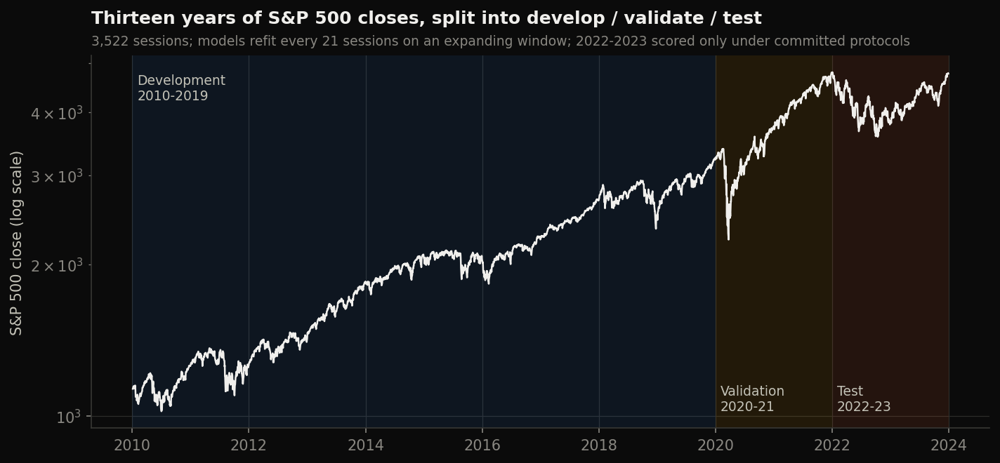 | ^GSPC close (log scale) vs date, partitions shaded | data | 2020 crash in validation, 2022 bear market in test | very different regimes across partitions, so period-specific results are expected |
| 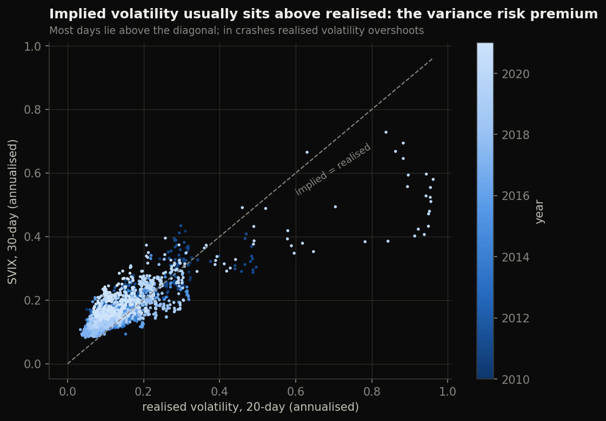 | SVIX vs 20-day RV, annualised | data | most points above the diagonal | variance risk premium: implied volatility is a biased P-signal |
| 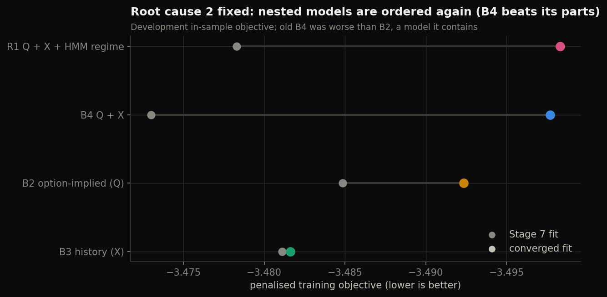 | penalised in-sample objective by model | E4 / E5 | original B4 worse than nested B2; converged order correct | non-convergence created spurious rankings |
| 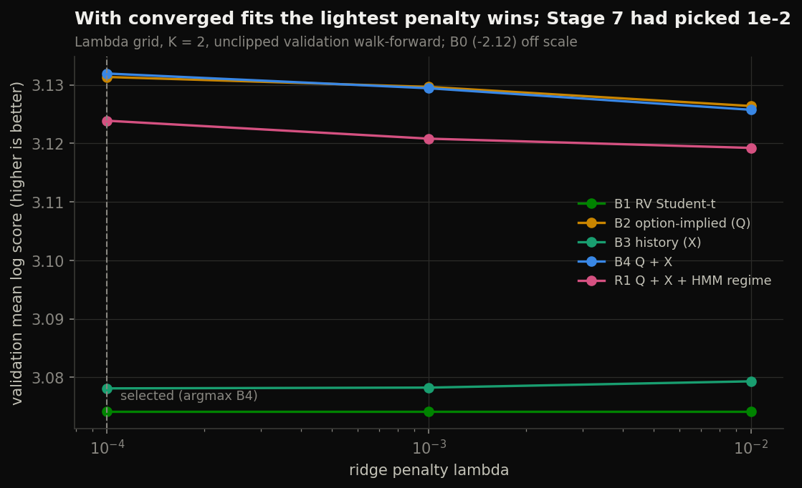 | validation log score vs λ (log axis) | E7 | lightest penalty best for B4 | λ choice reversed after convergence |
| 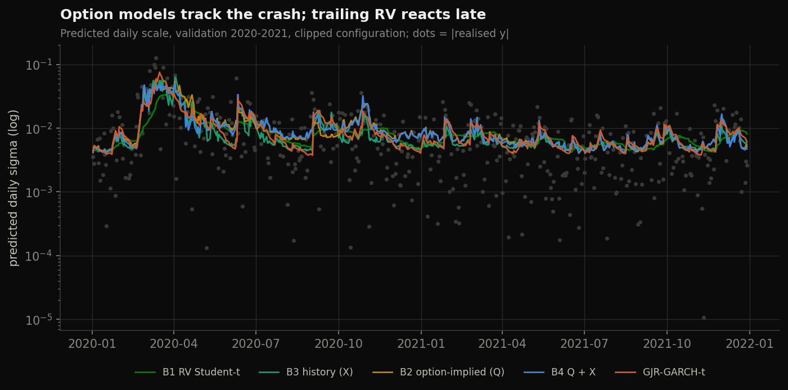 | predicted daily σ (log) vs date; dots are \|y\| | R-VAL | option models track the crash; RV-based model lags | supports the "scale" mechanism; not a significance test |
| 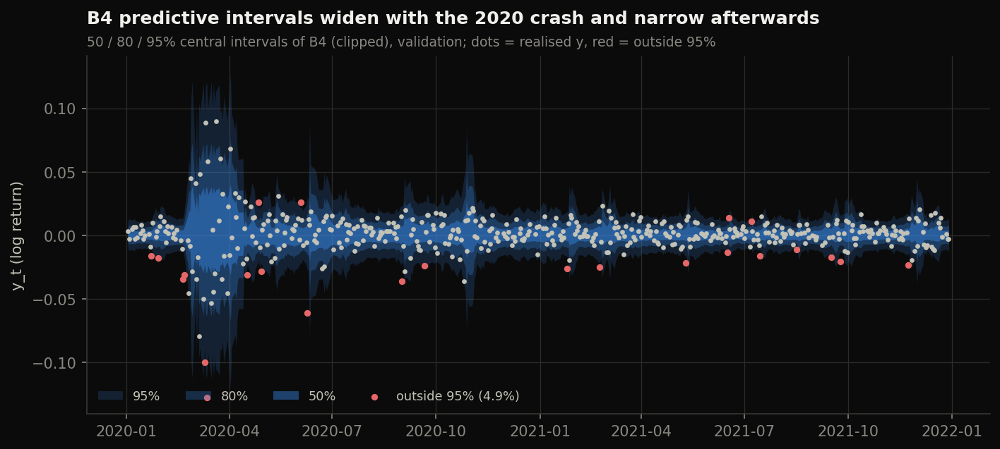 | B4 central 50/80/95% intervals and realised $y$ | R-VAL | intervals widen with the crash | visual calibration only |
| 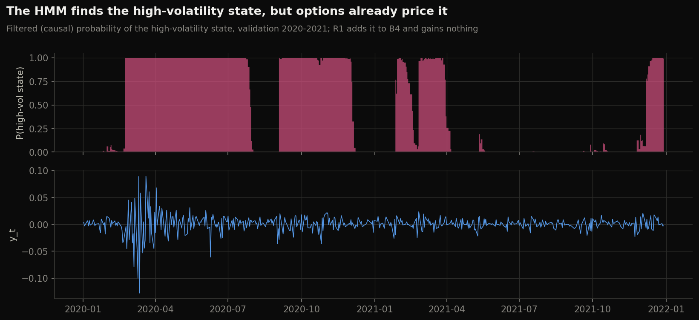 | filtered P(high-volatility state) and $y$ | R-VALU | HMM tracks volatility episodes | the state is largely spanned by Q + X |
| 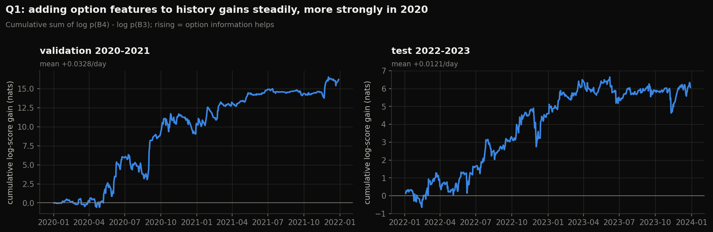 | cumulative $\sum d_t$ (nats) for B4 − B3 | R-VAL / R-TEST | steady rise in validation; flatter in test | the visual trend does not imply significance (test p = 0.052) |
| 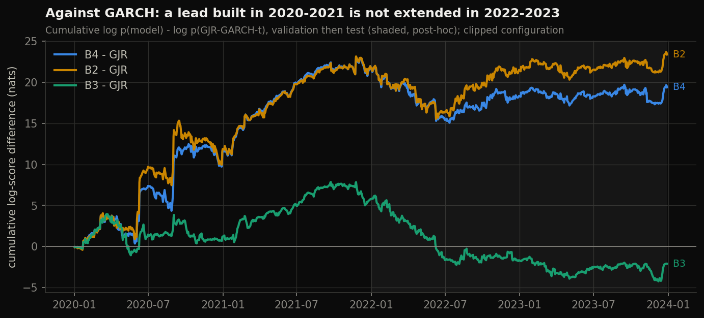 | cumulative log p(model) − log p(GJR) | R-VAL → R-TEST | lead built in 2020–21 not extended in 2022–23 | consistent with the post-hoc tie |
| 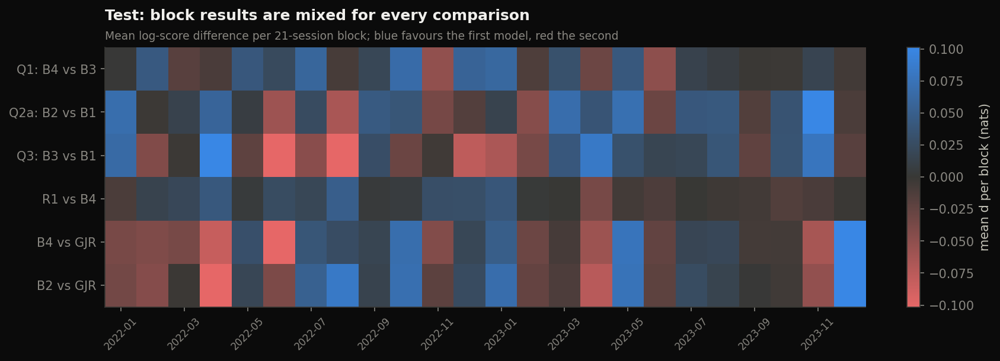 | per-block mean $d$ (diverging colour scale) | R-TEST | mixed signs in every row | effects are not uniform over time |
| 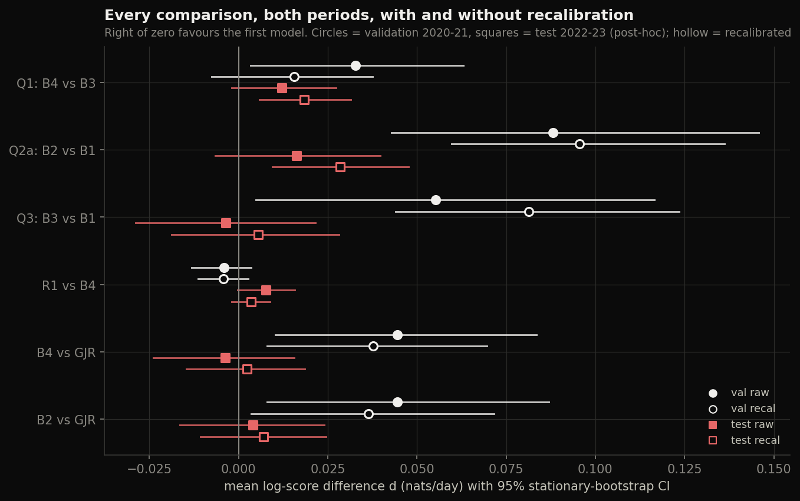 | mean $d$ with 95% bootstrap CI; four settings | R-VAL / R-TEST | validation CIs exclude 0 for Q1, Q2a, Q3 and vs GJR; most test CIs include 0 | the core summary of the evidence |
| 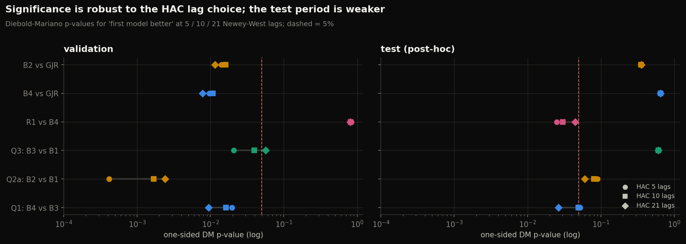 | one-sided DM p (log) at lags 5/10/21 | R-VAL / R-TEST | lag choice changes p modestly | robustness to the HAC bandwidth |
| 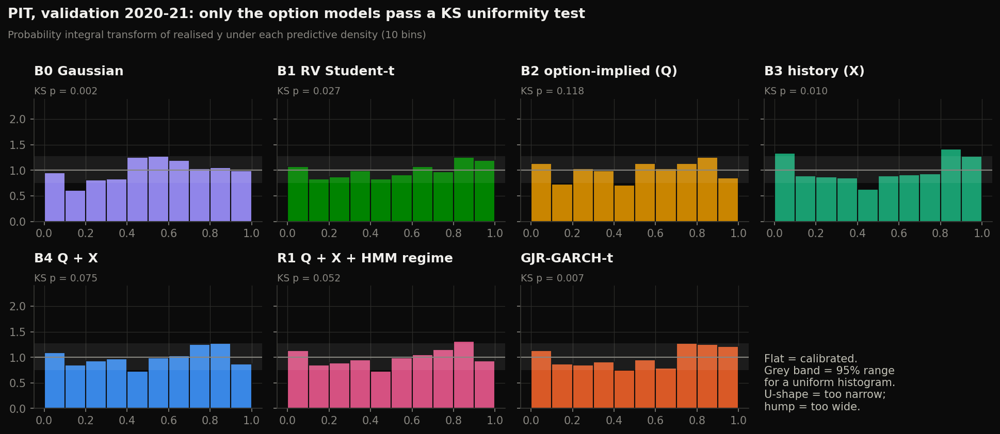 | PIT histograms with KS p | R-VAL | option models near-uniform | calibrated in 2020–21 |
| 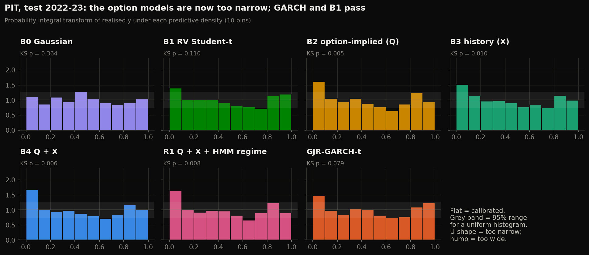 | PIT histograms (N = 501) | R-TEST | option models show central under-coverage | too narrow in 2022–23 |
| 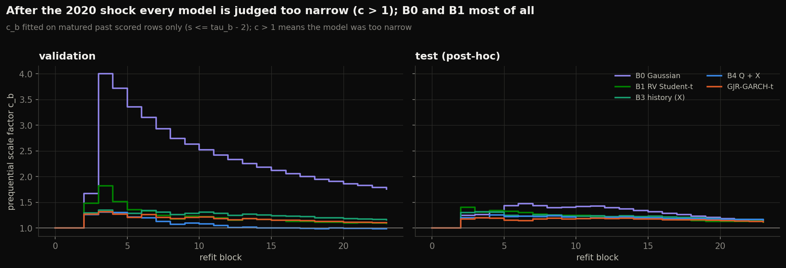 | prequential $c_b$ by block | E9 / E11 | $c_b>1$ after 2020 for most models | under-dispersion; factors are period-dependent |
| 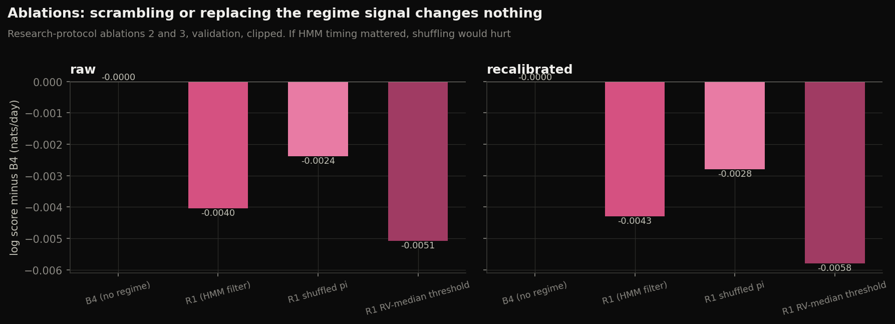 | log score minus B4, raw and recalibrated | E9 | all near 0 | no regime value |
| 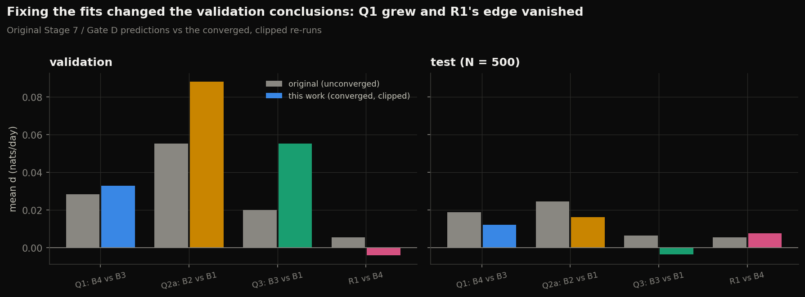 | mean $d$: original vs converged predictions | O vs R | Q1 grew and R1's edge vanished on validation | convergence changed the conclusions |
| 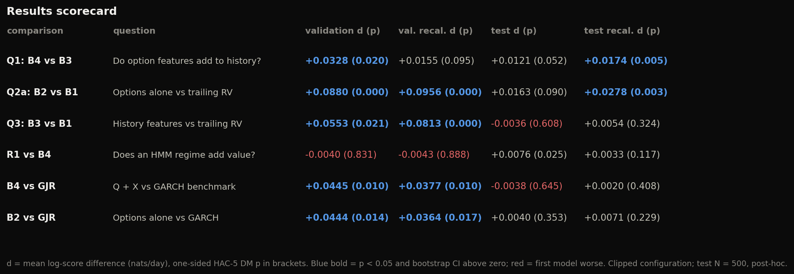 | scorecard of all comparisons (bold blue means p < .05 and CI > 0) | R-VAL / R-TEST | validation significant; test mostly not | the overall verdict |

Animations (`figures/gifs/`) provide intuition only:
- predictive densities through the COVID crash;
- a log-score race against GJR;
- a scrolling test fan chart;
- PIT build-up;
- the walk-forward refits.

## 25. Scientific interpretation

1. **Do option features add to historical features (Q1)?** On validation, yes: +0.033 nats/session (p 0.020, CI > 0, 17/24 blocks), robust to excluding the stress window and to the HAC lag. Under strict width control the gain is not significant (p 0.095). On test (post-hoc) the gain is +0.012 with p 0.052. The answer is **directionally consistent but not confirmed**.
2. **Do option-only models beat naive baselines?** Yes, versus B0 in both periods (test +0.092, p 0.001). Versus trailing RV (B1): strongly on validation (+0.088), weakly on test (+0.016, p 0.09).
3. **Do option models beat GJR-GARCH?** On validation yes (+0.045, p 0.010, surviving recalibration). On test it is a tie (−0.004, p 0.65).
4. **Does the HMM regime help?** No. The original H1 is inconclusive. The converged validation result is negative, and the ablations are null. The post-hoc test result (+0.008, p 0.025, CI includes 0, 2023 negative) does not meet the pre-registered standard or the 0.010 threshold.
5. **Scale, location or shape?** Mostly **scale**. The σ paths respond to option volatility, and width control removes about half of Q1 on validation. A formal location/shape decomposition was **not** performed (it is future work).
6. **Effect of convergence?** Material: λ, the regime sign, the calibration verdicts and the Q1 magnitude all changed (§14.7).
7. **Effect of clipping and width recalibration?** Clipping removed absurd σ and improved every model, but shrank Q1 (because B3 benefits more). Recalibration halved Q1 on validation but enlarged it on test, so it is unstable across periods.
8. **Calibration?** Good on validation for B2, B4 and R1. Too narrow on test for all option models.
9. **Robustness?** Validation effects hold across years, most blocks, stress exclusion and HAC lags. Test effects are smaller and do not survive the primary rule. Year splits differ, for example Q1 at +0.018 in 2022 and +0.006 in 2023.
10. **What survives the post-hoc limits?**
    - Option information is clearly better than naive baselines in both periods.
    - The regime model adds nothing.
    - On validation only, option information adds to history and beats a GARCH benchmark.
    - None of the test-period gains is confirmatory.

## 26. Limitations, threats to validity and future work

**Limitations.**
- **Scope:** one index, one horizon (one day) and one maturity (30 days). The horizon mismatch caps the information that option shape can contribute.
- **Sample size:** about 500 scored days per period. Effects of about 0.01 nats are near the detection limit.
- **Non-stationarity:** 2020 (crash) and 2022 (bear market) differ, and calibration flips between them.
- **Specification:**
  - collinear inputs;
  - a linear location and softplus-linear scale;
  - a constant ν (so tail gains cannot be expressed);
  - clipping as an ad hoc support guard.
- **Inference:**
  - DM asymptotics with volatility clustering;
  - the KS test under dependence;
  - several secondary comparisons with no multiplicity correction (BH was pre-registered but not applied);
  - validation used for tuning.
- **Test exposure:**
  - ^GSPC closes for 2022-01-03/04 were committed early, and ^IRX yields were also downloaded into January 2022;
  - the test period was scored at Gate D and rescored twice;
  - Q1 became the emphasis after the test had been observed.
- **Data:**
  - licensed raw data cannot be shared;
  - the vendor timestamp is unverifiable;
  - the forward-fill rule was applied to test only;
  - the 2016-11-11 moments were partly patched with hard-coded values;
  - the current batch script did not generate the committed CSVs.
- **Benchmarks:** no intraday benchmarks (HAR-RV, Realized GARCH).
- **Economics:** no trading or portfolio evidence.

**Future work (not completed).**
1. **Reliability:**
   - pin the environment;
   - add feature-pipeline tests on a licensed-data fixture;
   - re-estimate ρ and use multiple starts in the HMM;
   - drop π₀ from R1;
   - apply the forward-fill rule symmetrically and regenerate the features with the current scripts.
2. **Validation experiments:** BH correction and a Model Confidence Set over all variants; Politis–White block length; a rolling-window Giacomini–White test.
3. **Distributional specification:** skew-t or input-dependent tails, with tail-focused scores (censored likelihood, threshold-weighted CRPS, joint VaR–ES loss), and a formal scale/shape/location decomposition.
4. **Benchmarks:** GJR-X with VIX, filtered historical simulation, HAR on range-based RV, and a log-score-weighted linear pool.
5. **Fresh evaluation:** a genuinely unseen period would be required for confirmation. The project owner has stated that **no 2024+ data will be available**, so a confirmatory claim cannot be made within this project.
6. **Extensions:** horizon-matched (1/5/21-day) targets; weekly and 0DTE options for one-day horizons; other indices and assets.

## 27. Conclusion

- **The research question.** Thirty-day option-implied information improves one-day physical return-density forecasts **relative to naive baselines**, robustly. Its value **beyond historical risk measures** and **beyond a GJR-GARCH benchmark** is supported on validation but **not confirmed** on the (post-hoc) test period. The value acts mainly through forecast scale.
- **The methodological lesson.** Unconverged maximum-likelihood fits altered the hyperparameter choice, the sign of the primary regime comparison, the calibration verdicts and the model ranking. Convergence must be certified (gradient and positive-definite Hessian) and checked against an independent optimiser before model comparisons are interpreted.
- **Strongest results:**
  - converged, independently verified estimation;
  - options vs naive baselines in both periods;
  - Q1 and the advantage over GARCH on validation;
  - consistent null regime evidence.
- **Negative or inconclusive results:**
  - H1 is not supported;
  - Q1 test p = 0.052;
  - the GARCH comparison is a tie on test;
  - option-model intervals are too narrow in 2022–23.
- **Most defensible contribution.** A carefully audited, recalibration-controlled replication of the known horizon pattern (option information helps at one day mainly through scale) on 2010–2023 SPX data. It comes with pre-declared controls and a documented case of how numerical non-convergence can manufacture or reverse empirical conclusions.

---

# PART VI — Documentation quality and verification

## 28. Evidence conventions

Each claim is labelled by the kind of evidence behind it:
- **Code:** a module, function or class, read directly.
- **Saved artifact:** a JSON or CSV under `output/`.
- **Existing report:** a document under `docs/`. These are treated as claims, not as independent verification.
- **New read-only computation:** done for this report, with scripts and outputs in `docs/report_appendices/`.

External references are cited as recorded in `docs/literature/`. That review tags each reference by verification level, and anything it marks unverified is used here only for framing, never as evidence.

**Evidence actually inspected or executed for this report:**
- **Read:**
  - all `docs/*.md` (via structured extraction);
  - `src/features/*` and `src/models/*`;
  - every `tests/*.py`;
  - the experiment scripts;
  - the metadata JSON files;
  - the commit history.
- **Recomputed read-only from committed files:**
  - all generation-level metrics and paired statistics (Appendix B), including the exact original Gate D values (R1 − B4 +0.005417, p 0.0732, CI [−0.00198, +0.01384]);
  - dataset row counts and SHA-256 hashes, which match the metadata;
  - the target and `r_1d` alignment (to 1e-16);
  - the Hessian conditioning (Appendix C).
- **Not re-executed:** the full walk-forward runs, the test-period runners and the test suite. Their recorded outputs and commit messages are cited instead.
- **Not inspectable:** raw OptionsDX files, the true quote snapshot time, and the claim that test bundles stayed unopened before Gate D.

## 29. Contradictions and provenance

The complete catalogue, with file and line references, is in [Appendix A](report_appendices/A_experiment_inventory_and_provenance.md). The most consequential items:

1. **The primary question changed after the test was observed.** The pre-registered H1 is R1 vs B4. The revised README and the Step 8 protocol make Q1 (B4 vs B3) primary. That choice was made on 2026-10-28, after Gate D had scored 2022–2023. Every Q1 test result is therefore post-hoc in two senses.
2. **Original results that are numerical artefacts.** The λ choice, the R1 sign on validation and the B4/R1 calibration verdict all come from unconverged fits (§14.7). The original gate reports remain accurate *as records* of what the original code produced.
3. **B0 PIT bug.** The original reports state B0 KS p values of 0.044 (validation) and 0.321 (test); the correct values are 0.0017 and 0.3905.
4. **Scaler window.** Most original documents (Gate C, the Stage 5 specification, `implementation.md`) say the scalers use $t\le\tau$. The code uses $t\le\tau-2$, as does `docs/research_protocol.md` §6.2.
5. **DTE window and spread threshold.** The documents give 20–50 DTE (and 0.30 spread in one place); the code uses 15–90 DTE and 0.35.
6. **Forward-fill rule.** The protocol's isolated-gap forward-fill appears in the documents for all partitions. The code applies it **only to test**; validation keeps 9 missing dates.
7. **Rate handling.** The original metadata say "zero silent constant substitution". The original batch script substituted r = 0.015 silently. It was later patched, but the 2016-11-11 QKurt_30d and ATM_IV_60d were never recomputed.
8. **Test-exposure disclosure.** The ^GSPC exposure (2022-01-03/04) is disclosed. The ^IRX download to 2022-01-05 in the same script is not.
9. **HMM diagnostics.** `docs/research_protocol.md` L513 states dwell ≥ 17.6 and occupancy ≥ 19.8%, but no artifact supports either number. The JSON minima are dwell 40.96 and occupancy 26.4% (validation).
10. **Unbacked numbers in Gate C.** Several are not stored in any artifact:
    - an in-sample DM of 1.9165 (p 0.0277);
    - CRPS audit errors;
    - a σ range of [0.0039, 0.6767], whereas the CSV range is 0.0023–1.7264;
    - a B0 mean scale of 0.010000, whereas the CSV value is 0.010622.
11. **Pre-registered but not executed in the original:**
    - Politis–White block length (a fixed 5 was used);
    - studentized CIs;
    - Benjamini–Hochberg;
    - the ablations;
    - H2 and H4.

    The "frozen" protocol was also edited after Gate D (commits `6b2e3a4`, `7f06ab7`).
12. **HAC rationale.** The Stage 5 specification's "MA(1)" claim is wrong: targets do not overlap (§7).
13. **Within the revision's own outputs:**
    - The README §9 test PIT row and figures 31–32 use N = 501 rather than the primary N = 500 (e.g. GJR 0.079 vs 0.096).
    - The pre-fix values in figure 09 come from external audit notes, not from committed artifacts.
14. **Reproduction documents.** `docs/reproducibility_guide.md` lists five files that never existed and absolute local links. Re-running the original scripts on this branch would overwrite the original record.

**Provenance matrix.**

| Generation | Authoritative artifact | Authoritative narrative | Code state |
|---|---|---|---|
| O-VAL | `output/stage7_models/*.json`, `validation_predictions_primary.csv` | `docs/gate_c_model_validation_report.md` (B0 PIT corrected here) | commit `66924f3` |
| O-TEST | `output/stage8_test/test_metrics_summary.json`, `test_predictions*.csv` | `docs/gate_d_final_test_report.md`, `docs/final_research_report.md` | commit `67a9642` |
| Optimizer audit | `output/stage7_models_v2/step3_convergence_check.json`, `step4_hmm_b1_b0_check.json`, Appendix C | this report §14 | commits `029c16d`–`b5b2ed6` |
| R-VALU / R-VAL | `output/stage7_models_v2/*` | this report; README | commits `727539e`, `50672f7`, `43e5f31`, `0917f32` |
| R-TEST | `output/stage8_test_v2/*` | this report; README (with the N = 501 caveat) | commits `851d3a2`, `b990f7f` |

## 30. Verification checklist

| # | Check | Outcome |
|---|---|---|
| 1 | Equations vs implementation | Student-t density, penalty (slopes only), parameterisation, HMM recursion, GJR two-step and recalibration objective all checked against code |
| 2 | Central tables vs artifacts | Tables A–F and §22 are taken from Appendix B, which is generated from committed predictions. The original Gate D values reproduce exactly. |
| 3 | Generations separated | Every table is labelled O-VAL / O-TEST / R-VAL / R-VALU / R-TEST |
| 4 | Optimizer description vs code | checked against `density_models.py` (`_run_lbfgs`, `_newton_polish`, `StudentTRegression.fit`) |
| 5 | Referenced files exist | checked by script when this report was committed (§31) |
| 6 | Figure paths and captions | paths checked; captions checked against the figure script and data; N = 501 deviation disclosed |
| 7 | Test results labelled post-hoc | yes |
| 8 | Negative and inconclusive findings visible | H1, test Q1, test vs GJR, test calibration |
| 9 | Duplicated or contradictory conclusions | §25 and §27 are consistent with §21–§22 |
| 10 | No existing file modified | only `docs/complete_research_report.md` and `docs/report_appendices/*` were created |
| 11 | Uninspectable evidence reported | §28 |
| 12 | Read vs executed | §28 |

## 31. Files created for this report
- `docs/complete_research_report.md` (this document)
- `docs/report_appendices/A_experiment_inventory_and_provenance.md`
- `docs/report_appendices/compute_report_statistics.py` → `docs/report_appendices/detailed_statistics.md`
- `docs/report_appendices/compute_conditioning.py` → `docs/report_appendices/conditioning.md`

## References

Verification tags follow the repository's literature review (`docs/literature/research_notes/`):
- **[V]** checked there against an abstract, repository or RePEc record;
- **[U]** recorded there but marked not re-verified;
- **[KB]** a standard citation that does not appear in the repository's literature materials (bibliographic details from general knowledge).

Check every [U] and [KB] entry against the publisher's record before formal submission.

- [U] Bakshi, Kapadia & Madan (2003). "Stock return characteristics, skew laws, and the differential pricing of individual equity options." *Review of Financial Studies* 16(1).
- [V] Bliss & Panigirtzoglou (2004). Option-implied risk aversion estimates. *Journal of Finance* 59(1).
- [U] Bollerslev, Tauchen & Zhou (2009). "Expected stock returns and variance risk premia." *Review of Financial Studies* 22(11).
- [KB] Diebold & Mariano (1995). "Comparing predictive accuracy." *Journal of Business & Economic Statistics* 13(3).
- [KB] Glosten, Jagannathan & Runkle (1993). *Journal of Finance* 48(5) (GJR-GARCH).
- [U] Martin (2017). "What is the expected return on the market?" *Quarterly Journal of Economics* 132(1).
- [V] Neuberger (2012). "Realized skewness." *Review of Financial Studies* 25(11).
- [KB] Newey & West (1987). *Econometrica* 55(3) (HAC covariance).
- [KB] Politis & Romano (1994). The stationary bootstrap. *Journal of the American Statistical Association* 89(428).
- [V] "A multi-horizon comparison of density forecasts for the S&P 500 using index returns and option prices." *Journal of Banking & Finance* (2010). The title and venue are verified; the authors (Shackleton, Taylor & Yu) are recorded in the literature review as believed but not re-verified.
